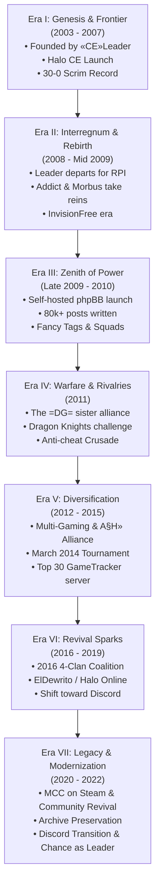

# Combat Experts Clan (`=CE=`) — Comprehensive Chronicle & History (2003 – 2022)

> **Motto:** *"Strength. Determination. Merciless. Forever."*  
> **Primary Arena:** *Halo: Combat Evolved*, *Halo Custom Edition*, *Halo 2 Vista*, *ElDewrito*, *Halo: The Master Chief Collection*  
> **Archival Scope:** Fall 2003 through January 2022 & The Discord Era  
> **Source Material:** Public historical archives, official community records, board logs, member documentaries (*combate1_php1.sql*), and the official Clan Charter (*charter.md*)  
> **Privacy Note:** In strict compliance with historical ethics and clan privacy standards, this document contains **zero** private communications and no personal real-world identities. All chronicles are drawn exclusively from public records, official clan broadcasts, documentaries, community forums, and public clan documents.

---

```text
       ██████╗ ██████╗ ███╗   ███╗██████╗  █████╗ ████████╗    ███████╗██╗  ██╗██████╗ ███████╗██████╗ ████████╗███████╗
      ██╔════╝██╔═══██╗████╗ ████║██╔══██╗██╔══██╗╚══██╔══╝    ██╔════╝╚██╗██╔╝██╔══██╗██╔════╝██╔══██╗╚══██╔══╝██╔════╝
      ██║     ██║   ██║██╔████╔██║██████╔╝███████║   ██║       █████╗   ╚███╔╝ ██████╔╝█████╗  ██████╔╝   ██║   ███████╗
      ██║     ██║   ██║██║╚██╔╝██║██╔══██╗██╔══██║   ██║       ██╔══╝   ██╔██╗ ██╔═══╝ ██╔══╝  ██╔══██╗   ██║   ╚════██║
      ╚██████╗╚██████╔╝██║ ╚═╝ ██║██████╔╝██║  ██║   ██║       ███████╗██╔╝ ██╗██║     ███████╗██║  ██║   ██║   ███████║
       ╚═════╝ ╚═════╝ ╚═╝     ╚═╝╚═════╝ ╚═╝  ╚═╝   ╚═╝       ╚══════╝╚═╝  ╚═╝╚═╝     ╚══════╝╚═╝  ╚═╝   ╚═╝   ╚══════╝
                                    = C E =   C L A N   C H R O N I C L E S   ( 2 0 0 3  -  2 0 2 2 )
```

---

## Table of Contents
1. [Executive Historical Summary](#1-executive-historical-summary)
2. [Chronological Era Timeline (2003 – 2022)](#2-chronological-era-timeline-2003--2022)
   - [Era I: The Genesis & The Golden Frontier (Fall 2003 – 2007)](#era-i-the-genesis--the-golden-frontier-fall-2003--2007)
   - [Era II: The Interregnum & The Rebirth (2008 – Mid 2009)](#era-ii-the-interregnum--the-rebirth-2008--mid-2009)
   - [Era III: The Sovereign Forum Era & The Zenith of Power (Late 2009 – 2010)](#era-iii-the-sovereign-forum-era--the-zenith-of-power-late-2009--2010)
   - [Era IV: Warfare, Scrims, Dramas & Rivalries (2011)](#era-iv-warfare-scrims-dramas--rivalries-2011)
   - [Era V: Diversification, Migration & Maturation (2012 – 2015)](#era-v-diversification-migration--maturation-2012--2015)
   - [Era VI: The Revival Sparks & The Twilight of Web Forums (2016 – 2019)](#era-vi-the-revival-sparks--the-twilight-of-web-forums-2016--2019)
   - [Era VII: Pandemic Reunion, Modernization & The Eternal Legacy (2020 – 2022)](#era-vii-pandemic-reunion-modernization--the-eternal-legacy-2020--2022)
   - [The Post-Website Era: Discord Migration, Modern Governance & Leadership (2022 – Present)](#the-post-website-era-discord-migration-modern-governance--leadership-2022--present)
3. [The Organizational Matrix: Hierarchy, Tags & Squads](#3-the-organizational-matrix-hierarchy-tags--squads)
   - [The Tag Hierarchy](#the-tag-hierarchy)
   - [Military Ranks & The Revered Hall](#military-ranks--the-revered-hall)
   - [The Dual Roster Framework: Classical Military Hierarchy vs. Modern Discord Charter](#the-dual-roster-framework-classical-military-hierarchy-vs-modern-discord-charter)
   - [Specialized Squads](#specialized-squads)
   - [The Cadet Branch: Combat Experts Cadets (`=CEC=`)](#the-cadet-branch-combat-experts-cadets-cec)
4. [Notable Member Biographies & Historical Roster](#4-notable-member-biographies--historical-roster)
   - [Founders & High Command (General, Colonel, Major, Captain)](#founders--high-command-general-colonel-major-captain)
   - [Revered Veteran Members (Group #40)](#revered-veteran-members-group-40)
   - [Lieutenants & Field Operatives](#lieutenants--field-operatives)
5. [Dedicated Server Deployments & Key Battlegrounds](#5-dedicated-server-deployments--key-battlegrounds)
6. [Clan Culture, Traditions & Memorable Lore](#6-clan-culture-traditions--memorable-lore)
   - [The Blood Gulch Tryout Ritual & The 1v1 Gauntlet](#the-blood-gulch-tryout-ritual--the-1v1-gauntlet)
   - [The Recruit Induction Protocol: "Welcome.txt"](#the-recruit-induction-protocol-welcometxt)
   - [The Spam Forum, Forum Games & The 2000 Count](#the-spam-forum-forum-games--the-2000-count)
   - [The Xfire Era & "Halownage" Archives](#the-xfire-era--halownage-archives)
   - [The Running In-Game Reference: "Durelle.exe"](#the-running-in-game-reference-durelleexe)
   - [The Mandatory Documentaries Rule (Forum 66)](#the-mandatory-documentaries-rule-forum-66)
   - [Brotherhood Across Borders](#brotherhood-across-borders)
7. [Epilogue: The 20-Year Legacy](#7-epilogue-the-20-year-legacy)

---

## 1. Executive Historical Summary

The **Combat Experts Clan** (`=CE=`) stands as one of the longest-running, most structured, and culturally resilient gaming institutions in competitive PC history. Born in the autumn of 2003 with the launch of *Halo: Combat Evolved* on PC, `=CE=` survived the entire arc of early 2000s internet gaming: from raw IP firewall routing and primitive dedicated servers, through the golden age of *Halo Custom Edition* map modding, the height of mid-2000s clan warfare, the rise and decline of independent phpBB community forums, to the modern revival across *ElDewrito*, Steam's *Halo: The Master Chief Collection*, and Discord.

Over its nineteen active years recorded in the web archives and its continued presence in the Discord era, `=CE=` was defined by:
- An **undefeated competitive record** in early clan wars (30 multi-map matches, 0 defeats).
- Military-grade organizational discipline, complete with strict promotional criteria, anti-cheat surveillance, and detailed logging.
- An artistic and technical output spanning custom Halo maps, competitive montages, graphics suites, podcasts, and server automation tools.
- A durable community culture that saw early recruits grow into adulthood, technical careers, and leadership, maintaining an active fellowship across two decades.

---

## 2. Chronological Era Timeline (2003 – 2022)



---

### Era I: The Genesis & The Golden Frontier (Fall 2003 – 2007)

When Bungie and Gearbox Software released *Halo: Combat Evolved* for Windows PC in September 2003, online gaming was still on the wild frontier of the internet. Dedicated servers were practically nonexistent, consumer routers lacked automated port forwarding, and Windows XP firewalls routinely blocked server hosting.

In the autumn of 2003, an engineer-minded gamer named **«CE»Leader** founded the **Combat Experts Clan** (`=CE=`). Refusing to accept peer-to-peer latency, Leader reverse-engineered packet traversal through Linksys hardware and Windows firewalls, successfully creating one of the earliest public dedicated servers in the entire Halo PC community. Leader subsequently codified this knowledge into an authoritative community manual, *"How To Setup a Halo Dedicated Server"*, distributing it freely across the internet and laying the foundational architecture for competitive PC Halo.

```text
"Clan creation date was fall of 2003… Halo had just come out and we were all hardcore junkies 
(true addicts... lol). I figured out how to break through the Linksys and Windows firewalls 
(at that time knowledge on this was short) and was able to setup one of the first public 
Halo servers... To my best knowledge, =CE= is possibly the longest running clan on the planet."
— «CE»Leader, Historical Archival Letter (preserved in Topic #56)
```

In May 2004, Gearbox released *Halo Custom Edition* (Halo CE), unlocking custom map creation and modification tools (HEK). Recognizing that standard Halo would eventually grow stale, «CE»Leader led the entire clan into Custom Edition. `=CE=` did not merely play on custom maps—they built them. «CE»Leader and officer **«CE»BIGBOOM** mastered the editing tools, releasing custom maps that achieved widespread circulation on *halomaps.org*. During this pioneering period, «CE»Leader established direct dialogue with **Tiamat**, the celebrated creator of *Coldsnap* and *Hugeass*, forging a creative ethos within `=CE=` centered around large-scale vehicle and tactical warfare.

During this initial era, `=CE=` operated with military-style preparation. «CE»Leader and his right-hand man, **=CE=Falcon** (his neighbor and best friend, who later enlisted in the U.S. Army Rangers), developed an exhaustive tactical operational doctrine:
- **Topographical Cartography:** Leader and Falcon spent dozens of hours wandering empty maps, mapping coordinate grids, lines of sight, ambush positions, weapon drops, and vehicle respawn timings.
- **Role Specialization:** Combatants were formally segregated into **"Static"** operators (designated snipers, heavy ordnance overseers, counter-snipers) and **"Dynamic"** operators (flag runners, vehicle assault crews, rapid-response flankers).
- **Vehicle Counters:** Specific weapon protocols were codified (such as deploying Longsword tactical airstrikes from vertical angles to neutralize heavy Mythos tanks).

This level of tactical discipline gave `=CE=` an unprecedented competitive record: **they fought approximately 30 multi-map, three-round clan wars and never lost a single match.** At its peak during this period, clan membership fluctuated between 150 and 300 active players, cycling annually with the school calendar (surging in autumn, peaking in December/January, and cooling off in midsummer). An early strategic alliance was forged during these years with **{IB} Infernal Blaze**, cemented by mutual respect between «CE»Leader and {IB} Inferno.

---

### Era II: The Interregnum & The Rebirth (2008 – Mid 2009)

In late 2007 / early 2008, the founding era came to an unexpected halt. «CE»Leader was accepted into one of the world's most prestigious electrical engineering institutions—the Electric Power Engineering program at Rensselaer Polytechnic Institute (RPI). Facing grueling academic demands, Leader made the difficult decision to abruptly step away from gaming, shutting down the original clan operations virtually overnight. Falcon transitioned into the Army Rangers, and the original clan operations drew to a close.

However, the spirit of `=CE=` refused to die. A core cadre of loyal members, led by **«CE»Addict** alongside veteran **Morbus**, resolved to resurrect the clan. Recognizing the legacy they inherited, Addict contacted «CE»Leader to seek his blessing. Leader formally passed the torch, commending Addict's honor, tactical acumen, and preservation of the original clan aura.

In 2008, Addict established a new community hub on **InvisionFree** (`z15.invisionfree.com/Combat_Experts_Clan`). They recruited fresh talent to rebuild the roster:
- A second recruit using the handle **=CE=Falcon** arrived (coincidentally sharing the callsign of Leader's original companion).
- **`SpAz!` (Ninja)** and **Ichigo** joined the vanguard.
- Crucially, Ichigo scouted and recruited a vibrant player named **=CE= Plague**, who would go on to become the single most prolific poster and daily conversational anchor in the clan's history.

On **May 9, 2009**, the reformed clan structure was formally codified, marking the official anniversary date celebrated by the second-generation brotherhood.

---

### Era III: The Sovereign Forum Era & The Zenith of Power (Late 2009 – 2010)

By late 2009, InvisionFree's hosted service proved too limited for the clan's expanding ambitions. Under the technical leadership of **«CE»Addict**, **=CE=Toxic**, **«CE»Chance**, **Ithiane (Aegisdragon)**, and **=CE=Alteran (Lantean)**, the clan acquired its own domain and launched an independent, self-hosted phpBB 3 community platform: `combatexpertsclan.com`.

The transition on **December 18, 2009** unleashed an explosion of community activity. Within the first two weeks of launch, members generated over 2,500 posts, averaging nearly 200 posts per day. By the end of 2010, the community had authored **79,305 posts in a single calendar year**, followed by **34,665 posts in 2011**, creating a vibrant digital home of over 143,000 public contributions.

**Annals of Community Discourse: Archival Record of Annual Volume & Era Dynamics (2009 – 2022)**

The quantitative pulse of the phpBB platform mirrors the life cycle of early 2010s PC gaming communities—from the explosive enthusiasm of independent self-hosting to the gradual migration toward modern real-time platforms:

| Historical Epoch / Year | Verified Public Posts | Era Dynamics & Cultural Milestones |
| :--- | :---: | :--- |
| **2009 (Dec 18–31)** | **2,502** | **The Sovereign Inception:** Rapid migration from InvisionFree to the independent domain `combatexpertsclan.com`. Over 2,500 posts were authored in the first two weeks as the brotherhood established custom themes, graphics suites, rank insignia, and foundational governance. |
| **2010** | **79,305** | **The Golden Zenith & Institutional Expansion:** The most prolific single year in clan history, averaging over 217 public posts per day. Defined by the formal codification of the Fancy Tag leadership echelon (`«CE»`), establishment of the RCON Squad and Documentaries archive (Forum 66), the POQ migration, the founding of the `=DG=` alliance, and a massive surge in recruitment. |
| **2011** | **34,665** | **Competitive Maturation & Inter-Clan Warfare:** Sustained high operational activity averaging ~95 posts per day. The competitive peak of organized clan wars, formal challenge registries (Forums 79/80), the `{DK}` Dragon Knights Blood Gulch showdown, and extensive anti-cheat hash-ban campaigns protecting the dedicated servers. |
| **2012** | **17,029** | **Diversification & The Biographies Initiative:** Stabilization of daily forum posting offset by branch-outs into contemporary PC titles (*Team Fortress 2*, *Call of Duty: Modern Warfare 2*, *Minecraft*, *Planetside 2*). Highlighted by the launch of the *Clan Biographies* project (Forum 104) and early fraternal ties with sister clan `A§H»`. |
| **2013** | **7,019** | **The Veteran Cadre & Collegiate Transition:** Maturation of the adolescent 2008–2010 cohort into university and professional careers. Board discourse shifted from raw post counts to personal milestones, technical server maintenance, and strategic inter-clan diplomacy. |
| **2014** | **1,418** | **The Fraternal Alliance & Real-Life Milestones:** Core activity consolidated around dedicated server matches and collaborative multi-clan events, headlined by the March 2014 multi-mode friendly tournament against `A§H»`. Real-time daily coordination increasingly migrated to voice platforms (Xfire, TeamSpeak). |
| **2015** | **821** | **The Dedicated Server Bastion:** Focused operational stewardship of the dedicated server fleet. Achieved the historic milestone of a `=CE=` dedicated Halo CE server ranking in the Top 30 globally on GameTracker a full twelve years after founding. |
| **2016 – 2019** | **416** | **The Twilight of Web Boards & The ElDewrito Spark:** The four-clan coalition pact (`=CE=`, `=DG=`, `A§H»`, `«RG»`) in early 2016 to sustain classic PC Halo; temporary resurgence in Forum 108 around *ElDewrito* (Halo Online) game nights; permanent day-to-day community migration to the official `=CE=` Discord server. |
| **2020 – 2022** | **30** | **The Pandemic Reunion, MCC PC & Archival Preservation:** Veterans reassembled on Steam for *Halo: The Master Chief Collection* and lockdown voice lobbies; containerization of the nineteen-year legacy codebase; transition of clan leadership to `«CE»Chance`; final reflective forum entry on January 14, 2022. |
| **Total** | **143,205** | **Nineteen years of continuous digital history preserved across 11,499 community topics.** |

This era was characterized by an elaborate military organizational structure. The community introduced distinct, prestigious symbols of leadership:
- **The Fancy Tags (`«CE»`):** Reserved exclusively for members of Leader rank—the highest honor achievable in the clan. Leaders bearing fancy tags during this era included `«CE»Addict`, `«CE»Thorn`, `«CE»eden`, `«CE»Chance`, `«CE»Music`, and `«CE»Fuyuri`.
- **The Standard Tags (`=CE=`):** Worn proudly by fully inducted active combatants from Private to General.
- **The Cadet Tags (`≈CE≈` / `-CE-`):** Assigned to recruits undergoing training in the cadet program (`=CEC=`).

To keep operations running smoothly, `=CE=` instituted specialized squads:
1. **The RCON Squad:** High-integrity server administrators entrusted with remote server console passwords. They were bound by strict documentation rules, mandating that every kick, ban, or warning be recorded with photographic or cryptographic hash evidence in the dedicated **Documentaries** archive (Forum 66).
2. **The Graphics Squad:** Headed by artists such as `«CE»Thorn` (an architectural CAD designer), `=CE=Drake`, and `=CE=Birdy`, this squad produced custom signature tags, rank insignia, userbars, and desktop wallpapers.
3. **The Scrim & Combat Squad:** Managed by `«CE»Music`, `Rampage`, and `«CE»Addict`, responsible for vetting competitive rosters, scouting opposing clans, and organizing scrimmages.
4. **The Event & Podcast Squad:** Producers of the official `=CE= Podcast` and organizers of seasonal community tournaments (such as the *Holiday Hangover Event*, *Halloween Custom Map Bash*, and tryout mixxers).

---

### Era IV: Warfare, Scrims, Dramas & Rivalries (2011)

The high visibility of `=CE=` dedicated servers made the clan a central player in community diplomacy, intense rivalries, and external conflicts.

#### 1. The POQ Exodus & The Genesis of =DG= (Early 2010)
In February 2010, internal conflicts erupted in the neighboring `POQ` clan. High-ranking POQ server host **POQbum** made the controversial decision to leave his clan and apply to `=CE=`. The move triggered gossip and tension across the Halo community.

`=CE=` leadership demonstrated exemplary maturity:
- On February 24, 2010, officer **Angel** and admin **Phantom** issued an official decree (*Topic #1251: "=CE= and POQ Drama All READ"*), ordering all `=CE=` members to cease gossip, treat POQbum strictly as a standard recruit, and respect POQ's sovereignty.
- POQbum integrated smoothly, bringing high-performance dedicated server infrastructure into `=CE=`.
- In July 2010, POQbum launched a sister clan initiative named **=DG= (Dark Guardians)** (Topic #3279), reviving the historic namesake on `DGclan.com` while maintaining shared servers with `=CE=`. When POQbum briefly stepped back, players like `=CE=Birdy` found refuge in `=CE=`'s open doors.

#### 2. The Complex =DG= Alliance: Brothers, Rivals & Mixed Blood
For over half a decade, `=DG=` served as `=CE=`'s most intricate alliance:
- **The Dual-Citizen Roster:** Numerous players held dual status or transitioned between both clans (notably `=CE=Exeon`, who served as an Admiral in `=DG=` while holding Sergeant rank in `=CE=`).
- **The "Who Would Win?" Debate (Topic #6556):** In January 2011, a 96-reply community debate ignited over whether `=CE=` or `=DG=` would prevail in a full-scale scrimmage. `=CE= Plague` famously declared that *"the power of both clans ends up destroying the universe and we end up in a draw."*
- **Joint Mixxers & Server Ties:** The two clans co-hosted numerous community events and shared admin privileges across mutual servers.
- **The 2015 Friction & Reconciliation:** In June 2015 (Topic #12808), during an unexpected `=CE=` forum outage, `=DG=` temporarily removed `=CE=` from their official ally roster citing perceived inactivity. Stalwarts `=CE=xZy`, `=CE=UGoBoom`, and `=CE=Shy` rallied the council to reassert `=CE=`'s enduring presence, reaffirming the unbreakable historical tie between the two clans.

#### 3. Scrimmage Showdowns: The Dragon Knights `{DK}` Affair
Between 2010 and 2012, dozens of clans issued formal scrimmage challenges to `=CE=` via the challenge registry (Forums 79 and 80), including `Team Rebellion`, `TeamMods (=TM=)`, `Clan Delta`, `»SG«`, `RIOT`, and `{DK} Dragon Knights`.

The most memorable confrontation occurred in March–April 2011 with `{DK}`:
- {DK} leader Ammar issued an urgent 6v6 challenge on Blood Gulch (Snipers, no shields, Warthogs only).
- `=CE=` noticed that {DK} had cloned their website styling and layout.
- An extensive scheduling effort ensued, managed by `«CE»Music`, `Rampage`, and `Plague`, complicated by a grueling 10-hour timezone difference between North America and the Middle East.
- On Saturday, April 23, 2011, the `=CE=` strike team (`Music`, `Blank`, `Hell`, `Tickle`, with `Addict` and `Plague` in reserve) assembled on the match server. After granting a 15-minute grace period, {DK} failed to appear, resulting in an official forfeit victory for `=CE=`.

#### 4. The Anti-Cheat Crusade & Imposter Wars
Because `=CE=` hosted the most populated public servers in Halo CE (including *Coldsnap*, *Ambush*, *FTLoBG*, and *Zombies*), they were constantly targeted by malicious actors:
- **Aimbotters & Wallhackers:** The RCON squad mounted a forensic campaign against notorious repeat cheaters (such as the tracking and unmasking of wallhackers like *Grimcall* and botters like *jesusJMF* and *kris_kof_df*).
- **The Hash-Ban Doctrine:** Rather than issuing arbitrary IP bans (which could be bypassed via dynamic IP resets), administrators were trained to extract and record unique CD-key cryptographic hashes, banning offenders permanently from all `=CE=` infrastructure.
- **Imposters:** Cheaters frequently masqueraded under clan tags (such as fake `=CE= tOx!C` and imposter leader handles). The RCON team maintained a zero-tolerance policy, deploying administrative scripts and spectator verification before taking swift action.

---

### Era V: Diversification, Migration & Maturation (2012 – 2015)

By 2012, the PC gaming ecosystem had broadened significantly. While Halo Custom Edition remained the foundational game of the clan, members actively branched out into contemporary titles. Dedicated squads were mobilized for *Team Fortress 2*, *Call of Duty: Modern Warfare 2*, *Garry's Mod*, *Minecraft* (with custom clan server builds), and *Planetside 2*, while competitive teams tested the waters in *Halo 2 Vista*.

During this era, a vital sister alliance formed with the **`A§H»` Clan (The A§H Clan, theASHclan.org)**, established around 2012 by **Crash** and **SONOR** (after BMF inspired Sonor, Sonor reached out to Crash, and the two co-founded the clan with Crash serving as its primary founder and guiding leader). Rapidly gaining acclaim for their well-moderated dedicated servers, `A§H»` became a close companion community to `=CE=`. Strong friendships crossed between the two rosters, with players like **`=DG=Enzo`**, **`Mandalor` (formerly `sHiNe!`)**, **`Voltagen`**, and former `=CE=` veteran **`=CE=Greed`** (`br0wnbr0th4`) sharing active ties across both clans.

This alliance culminated in an organized event in March 2014 (Topic #12394), when `A§H»Killer` (former `FoV` Hitman) proposed a multi-mode friendly tournament between `=CE=` and `A§H»` across both clans' servers. Featuring an intricate bracket scoring system (1 point per CTF capture, 1 point per Slayer kill, 5 points for the last survivor in Zombies, up to 75 points max), the tournament brought together `A§H»Killer`, `Mandalor`, `Enzo`, `Willrok`, `Voltagen`, and `Runriot` against `=CE=`'s `«CE»Addict`, `=CE=Giuli`, `=CE=Shy`, `=CE=Warthog`, and `=CE= Pydro`. The event highlighted the warm sportsmanship and mutual respect that carried both communities forward.

Simultaneously, the Biographies project launched in November 2012 by `«CE»Fuyuri` (Forum 104) captured a poignant transition: the adolescent recruits of 2008–2010 were graduating from high school and university, entering careers, and navigating adult milestones. `«CE»Thorn` was advancing in architecture and CAD design in Australia; `«CE»Chance` was pursuing software engineering at the University of West Florida; `«CE»Fuyuri` was building an IT career in New Zealand; `=CE=Ground` was rising from a high school freshman to Colonel while pursuing computer engineering; `=CE=Exeon` was balancing astrophysics studies at UCL with work at BAE Systems; `=CE=Four` (Inferno) was balancing full-time work and college prep in Ohio, rising to Captain twice; and `=CE=Durelle` was working in web infrastructure in Canada while maintaining a prominent sniping reputation (*"Durelle.exe"*).

Despite the aging of Halo CE's master browser, `=CE=`'s technical staff maintained exceptional round-the-clock stability. In late October 2015 (Topic #12841), `«CE»Addict`, `=CE=Shy`, and `=CE=UGoBoom` celebrated a historic milestone: **a `=CE=` dedicated Halo server achieved a Top 30 global rank on GameTracker**—a full twelve years after the clan's founding.

---

### Era VI: The Revival Sparks & The Twilight of Web Forums (2016 – 2019)

By early 2016, physical retail copies of Halo PC were long out of print, and online lobby populations were dwindling worldwide. Recognizing the threat to classic PC Halo, `A§H` diplomat and leader **Crash** approached `«CE»Addict` and clan leadership in January 2016 (Topic #12881) with a historic proposal: forming a formal "United Nations" coalition among the four enduring pillar clans—**`=CE=`**, **`=DG=`**, **`A§H»`**, and **`«RG»`**. Crash proposed pooling active player bases across joint dedicated servers, sharing real-time anti-cheat intelligence against aimbotters and hash-banned cheats, and coordinating joint cross-clan events. `«CE»Addict`, `«CE»Chance`, and `«CE»Thorn` entered diplomatic talks, establishing foundational **Autonomy** and **Sustainability** clauses to guarantee each clan's sovereign independence. The resulting four-clan summit, convened in `=DG=`'s Discord in February 2016, created a vital mutual support pact that sustained the remaining veteran communities through the twilight of the standalone game.

Shortly thereafter, between 2016 and 2018, the PC Halo community experienced an electric resurgence through **ElDewrito** (Halo Online). For `=CE=`, this was a spiritual homecoming. The clan established Forum 108 (*ElDewrito*), organizing community game nights where veterans and newcomers relived classic Halo 3-style multiplayer with modern PC mouse-and-keyboard precision.

As the decade drew to a close, modern voice and text platforms permanently supplanted traditional web bulletin boards across gaming culture. While forum post frequency tapered off, the brotherhood did not dissolve; it migrated. The official `=CE=` Discord server became the primary daily headquarters for voice lobbies, banter, gaming sessions, and life updates, while the web forum was preserved as the archival record of the clan's formative years.

---

### Era VII: Pandemic Reunion, Modernization & The Eternal Legacy (2020 – 2022)

When global lockdowns took effect in the spring of 2020, veterans who had not logged into the website in years returned to check on their brothers. Threads were revived with roll calls as `~CE~Trael`, `=CE=Giuli`, `Cactuar`, `=CE=Alteran`, and `«CE»Addict` checked in, counting posts and sharing well-wishes. Members reassembled on PC to squad up in *Halo: The Master Chief Collection (MCC)* on Steam, bringing the journey full circle back to classic Master Chief campaigns and multiplayer lobbies across *Halo: Reach*, *Combat Evolved Anniversary*, and *Halo 3*.

During this period of renewed connection, clan leadership addressed the long-term stewardship of the community's assets. In July 2020, `=CE=Toxic` organized an initiative seeking contributors to modernize the clan's web infrastructure, transitioning nineteen years of community history and discussion archives into secure, containerized environments so that `=CE=`'s legacy would remain permanently preserved.

In May 2021, `«CE»Addict` announced a promotion within High Command (Topic #13252). Citing twelve years of server hosting and systems maintenance, Addict invested `=CE=Toxic` with the chevron Fancy Tags, elevating him to Leader rank (`«CE»Toxic`). Meanwhile, the clan's supreme governance prepared for its next generational chapter: `«CE»Chance` was positioned to step forward as **the Leader of the Combat Experts Clan**, succeeding Addict at the head of the community.

The final recorded entry in the historic forum database occurred on **January 14, 2022**, in a discussion with `=DG=Morgan` titled *"What killed all the forums in the world (almost all)?"*. Reflecting on the broader evolution of internet culture, members noted the permanent shift toward real-time platforms like Discord, while fondly recalling the classic ritual of logging onto phpBB boards in the morning with coffee to read unread posts. With that reflective exchange, the sovereign web forum epoch drew to a graceful close, paving the way for the Discord-centric modern era.

---

### The Post-Website Era: Discord Migration, Modern Governance & Leadership (2022 – Present)

Following the conclusion of the forum's active history in early 2022, the clan completed its final platform evolution, transitioning from an archival web-based forum into a modern real-time gaming community:

- **Decommissioning the Website:** With gaming culture and clan operations shifting permanently to modern real-time platforms, the historic phpBB community site was formally retired and shut down, with its nineteen years of records carefully preserved in secure, containerized archives.
- **The Discord Hearth:** All primary operations—daily communications, voice lobbies, event planning, and cross-game matchmaking—permanently transitioned to the official **=CE= Discord** server, which serves as the active headquarters of the clan today.
- **The Modern Clan Charter (c. 2022):** Rather than allowing clan standards to erode with the loss of traditional forum boards, leadership codified the official **Clan Charter** to govern the new Discord era. This constitution adapted `=CE=`'s military heritage to accommodate the realities of an adult membership:
  - *Streamlined Recruitment & Observation:* Aspiring Spartans apply directly within dedicated Discord channels or during live events attended by an Officer. Accepted applicants receive the historic probationary `-CE-` tag and the Member Discord role. Over an active one-week observation period, the community reviews their demeanor; if conduct remains honorable and no objections are raised, the dashes are dropped and the recruit is awarded the full `=CE=` tags.
  - *Member Autonomy & Interest Groups:* Recognizing that veterans now balance careers, families, and adult responsibilities, rigid forum activity quotas were formally abolished. Full members participate at their leisure and are encouraged to form and join specialized interest Groups.
  - *A Proportional Officer Corps:* The Officer corps was reorganized on a proportional ratio relative to total clan size. Candidates are nominated by peers based on merit and passion for leadership, confirmed by vote. To maintain an active leadership pulse, Officers are expected to attend at least one clan event or contribute on Discord monthly.
  - *Independent Server Administration:* With the retirement of dedicated forum administrator roles, members who host servers for the clan administrate at their leisure under clan guidelines.
- **«CE»Chance as Leader:** With the sunset of the website, **«CE»Addict** formally designated **«CE»Chance as the Leader of the Combat Experts Clan**. A foundational pillar of reason, intellect, and leadership since May 9, 2009, Chance helms the modern Discord era, guiding `=CE=` into the future alongside `«CE»Addict` and `«CE»Toxic` (Leader rank).
---

## 3. The Organizational Matrix: Hierarchy, Tags & Squads

### The Tag Hierarchy
A member's tags in game and on the forums conveyed their status and standing within the clan:

| Tag Format | Designation | Description & Qualifications |
| :--- | :--- | :--- |
| **`«CE»Username`** | **The Fancy Tag** | **Leader Rank & Supreme Council.** Reserved for members holding the rank of Leader who governed clan policy, finance, server infrastructure, and strategic diplomacy. |
| **`=CE=Username`** | **Standard Tag** | **Full Clan Member.** Awarded to initiated Spartans from Private First Class through General who had passed tryouts, application votes, and background hash checks. |
| **`≈CE≈Username`** | **Cadet Tag** | **Combat Experts Cadets (`=CEC=`).** Worn by junior recruits and cadet officers undergoing formal training and behavioral evaluation. |
| **`-CE-Username`** | **Probationary / Recruit** | Worn by new applicants and recruits during their initial probationary evaluation period. |

---

### Military Ranks & The Revered Hall

```text
               ┌────────────────────────────────────────────────────────┐
               │              THE COMBAT EXPERTS HIERARCHY              │
               ├────────────────────────────────────────────────────────┤
               │   SUPREME COMMAND   : «CE» Leadership (Fancy Tags)     │
               │   HIGH COMMAND      : General, Colonel, Major          │
               │   OFFICER CORPS     : Captain, Lieutenant              │
               │   NON-COMMISSIONED  : Sergeant, Specialist             │
               │   ENLISTED RANKS    : Private First Class, Private     │
               │   PROBATIONARY      : Recruit, Cadet (≈CE≈)            │
               ├────────────────────────────────────────────────────────┤
               │   THE REVERED HALL  : Retired Veteran Members          │
               └────────────────────────────────────────────────────────┘
```

#### The Revered Group (Group #40)
The highest honor bestowed upon a veteran departing active duty. Defined officially in clan law as:  
> *"This group consists of people that are former members of =CE= that contributed something of worth towards =CE=."*

---

### The Dual Roster Framework: Classical Military Hierarchy vs. Modern Discord Charter

Throughout its history, `=CE=` maintained two distinct organizational models: the **Classical Military Hierarchy** that governed the sovereign forum era (2003–2021) and the **Modern Charter Matrix** that governs the Discord era (2022–Present).

#### 1. The Classical Military Hierarchy (2003 – 2021)
During the sovereign website epoch, promotion was earned through forum post milestones, scrimmage victories, server administration hours, and peer votes across nine military grades:

| Echelon | Military Grade | Requirements & Scope |
| :--- | :--- | :--- |
| **Supreme Council** | **Leader (`«CE»`)** | Supreme executive authority, fancy tags, board administration, diplomatic treaties. |
| **High Command** | **General (`=CE=`)** | Senior executive oversight, highest military grade, command of entire combat roster. |
| | **Colonel (`=CE=`)** | Senior commanders overseeing multiple squads, server clusters, and disciplinary appeals. |
| | **Major (`=CE=`)** | Strategic leaders directing specialized divisions (RCON, Scrim, Graphics, Cadets). |
| **Officer Corps** | **Captain (`=CE=`)** | Senior field commanders, server administrators, tryout evaluators, and forum moderators. |
| | **Lieutenant (`=CE=`)** | Junior officers, tryout judges, squad second-in-commands, and RCON operators. |
| **Non-Commissioned** | **Sergeant (`=CE=`)** | Seasoned combatants, forum anchors, match reserves, and cadet trainers. |
| | **Specialist (`=CE=`)** | Dedicated technical, artistic, or operational contributors. |
| **Enlisted Ranks** | **Private First Class (`=CE=`)** | Active Spartans who completed initial combat probation. |
| | **Private (`=CE=`)** | Fully inducted members awarded full standard `=CE=` tags. |
| **Probationary** | **Recruit / Cadet (`≈CE≈` / `-CE-`)** | Applicants in tryouts or cadet academy evaluation. |

#### 2. The Modern Charter Matrix (2022 – Present)
Adopted with the retirement of web forums, the modern charter instituted a streamlined structure suited to an adult brotherhood balancing careers and gaming:

```text
┌────────────────────────────────────────────────────────────────────────┐
│                      MODERN DISCORD CHARTER ROLES                      │
├───────────────────┬─────────────┬──────────────────────────────────────┤
│ Discord Role      │ Tag Format  │ Responsibilities & Standing          │
├───────────────────┼─────────────┼──────────────────────────────────────┤
│ Leader            │ «CE»        │ Executive guidance, fancy tags.      │
│                   │             │ Elected by Leaders; monthly presence.│
│                   │             │ «CE»Chance serves as The Leader.     │
├───────────────────┼─────────────┼──────────────────────────────────────┤
│ Officer           │ =CE=        │ Operational and event coordination.  │
│                   │             │ Nominated on merit; voted by peers.  │
│                   │             │ Monthly Discord/event participation. │
├───────────────────┼─────────────┼──────────────────────────────────────┤
│ Member            │ =CE=        │ Full Spartans. Leisure participation.│
│                   │             │ Access to interest Groups.           │
├───────────────────┼─────────────┼──────────────────────────────────────┤
│ Recruit           │ -CE-        │ Probationary status (1-week trial).  │
│                   │             │ Voted to full =CE= upon completion.  │
└───────────────────┴─────────────┴──────────────────────────────────────┘
```

---

### Specialized Squads

1. **RCON Squad:** The server administration and enforcement unit of `=CE=` dedicated servers. Empowered with remote server control passwords, members were bound by strict accountability rules. Abuse of admin powers resulted in immediate stripping of rank.
2. **Graphics Squad:** Created userbars, clan logos, desktop backgrounds, and customized forum avatars. Their artwork gave `=CE=` one of the most distinctive visual signatures in the Halo PC scene.
3. **Mapping Squad:** Continued the proud tradition of «CE»Leader and «CE»BIGBOOM, creating, modifying, and hosting custom multiplayer maps.
4. **Video Squad:** Captured Xfire recordings and edited cinematic frag montages showcasing clan tryouts, scrim victories, and humorous glitch antics for YouTube.
5. **Event & Podcast Squad:** Planned community mixxers and produced the `=CE= Podcast`, discussing clan news, gaming industry trends, and interviews with community personalities.

---

### The Cadet Branch: Combat Experts Cadets (`=CEC=`)
Recognizing that many eager applicants were too young or lacked competitive seasoning for the main roster, `=CE=` established a dedicated feeder academy: **Combat Experts Cadets (`=CEC=`)**.
- Cadets wore the distinctive tilde tags: **`≈CE≈`**.
- They advanced through an independent cadet hierarchy: *Cadet Recruit → Cadet → Cadet Lance Corporal → Cadet Corporal → Cadet Warrant Officer → Officer Cadet*.
- Senior officers served as instructors (such as `«CE»Thorn` and `[TS]` instructors).
- Dedicated training forums (Forums 97, 98, 99, 103) taught server etiquette, anti-cheat detection, teamwork, and marksmanship. Cadets who demonstrated character and loyalty were eventually promoted into full `=CE=` Spartan status.

---


## 4. Notable Member Biographies & Historical Roster

### Founders & High Command (General, Colonel, Major, Captain)
*(Members who attained senior executive and command rank within the classical military hierarchy)*

#### «CE»Leader (Founder, 2003 – 2008)
Founder of the Combat Experts Clan in the autumn of 2003. A technical pioneer who bypassed early router firewalls to establish one of the first public dedicated Halo PC servers. Author of the community manual *"How To Setup a Halo Dedicated Server"*, co-creator of custom maps alongside «CE»BIGBOOM, and commander during `=CE=`'s undefeated 30–0 early clan war record prior to departing for engineering studies at RPI.

#### «CE»Addict (General, 2008 – Present)
Central administrator and restorer of second-generation `=CE=`. Following Leader's departure, Addict revived the clan on InvisionFree with Leader's blessing and financed and launched the self-hosted phpBB platform in December 2009. Holding the rank of General and wearing the chevron Fancy Tags, Addict directed clan administration, recruitment policy, and server operations across more than a decade.

#### «CE»Chance (The Leader, Colonel, 2009 – Present)
Registered on May 9, 2009 (User #4). A computer science scholar who served as forum administrator, Colonel, and key operational coordinator throughout the sovereign web era. Formally designated by «CE»Addict as **the Leader of the Combat Experts Clan** upon transition to the modern Discord charter, Chance directs modern community governance and organizational affairs.

#### «CE»Thorn (Lord Thorn) (Colonel, Leader Rank, 2008 – Present)
Registered on May 9, 2009. An architectural CAD designer who advanced through the officer ranks to Colonel and Leader rank. Thorn directed the Graphics Squad, designed the clan's visual identity and rank userbars, and served as chief instructor for the Cadet Academy (`=CEC=`).

#### «CE»Toxic (2x Major, Leader Rank, 2009 – Present)
Registered on December 13, 2009 (User #53). Toxic managed dedicated server hosting, security configurations, and technical maintenance. After completing an initial term as Major, he re-climbed the promotional ladder to earn the rare distinction of **2x Major**. In May 2021 (Topic #13252), Addict invested him with the chevron Fancy Tags, elevating him to Leader rank (`«CE»Toxic`) in recognition of over a decade of systems administration.

#### «CE»eden (Grif / Chewie) (Major, Leader Rank, 2010 – Present)
Registered in early 2010, author of 6,212 posts. Rising to Major and Leader rank, eden was an active presence across community servers and discussion forums. Known for his support of new recruits and consistent participation in multi-game squads, eden served as a core leader during the forum epoch.

#### «CE»Music (Major, Leader Rank, 2009 – Present)
Registered in December 2009, author of 1,263 posts. Rising to Major and Leader rank, Music commanded the Scrim & Combat Squad, organizing match schedules, negotiating clan war parameters, and coordinating the competitive roster during the 2010–2012 scrimmage era.

#### «CE»Fuyuri (Major, Leader Rank, 2010 – Present)
Registered in 2010, author of 2,788 posts. An IT specialist from New Zealand who rose to Major and Leader rank. Fuyuri served as an officer, server administrator, and coordinator of the **Clan Biographies (Forum 104)** project, documenting member profiles and community history.

#### «CE»Ithiane (Aegisdragon) (General, 2009 – Present)
Registered on December 13, 2009, author of 2,748 posts. Holding the rank of General, Ithiane served as a senior forum administrator and server enforcer, overseeing disciplinary reviews, anti-cheat enforcement, and administrative policy during the height of the phpBB era.

#### =CE=Ground (Colonel, 2009 – Present)
Registered in December 2009, author of 1,729 posts. Joined as a high school freshman and advanced through the ranks to Colonel while completing computer engineering studies. Ground contributed regularly to technical discussions, server management, and community policy formulation.

#### =CE=ÅltyFox (=CE=Alteran / Lantean) (Captain, 2009 – Present)
Registered on December 13, 2009, author of 4,277 posts. Alteran served as Captain, forum moderator, and server guardian during the website era. During the transition to Discord, Alteran engineered the community's automated bot infrastructure (`AltyBot#4373`).

#### =CE=Birdy (Captain, 2010 – Present)
Registered in January 2010, author of 4,874 posts. A British designer who joined following the POQ transition, Birdy attained Captain rank, designed clan visual assets in the Graphics Squad, and administered UK-based servers.

#### =CE= FrightfulFerno (=CE=Ferno / Inferno / Four) (2x Captain, 2009 – Present)
Registered on December 13, 2009, author of 5,593 posts. Ferno advanced to Captain twice across two distinct active epochs, serving in the Scrim Squad and forum moderation.

#### «CE»RedFlag (Major, Revered, 2009 – Present)
Registered on December 13, 2009 (User #16), author of 2,367 posts. Promoted to Major in Topic #1739 with fancy tags awarded, RedFlag served as a senior RCON administrator and co-founded the clan's Steam community group in December 2009. RedFlag holds Revered status (Group #40) for longtime organizational service.

#### =CE= Chris (Captain, 2009 – Present)
Registered on December 13, 2009, author of 1,189 posts. Chris served as Captain, tryout judge in the Application Squad, and coordinator for seasonal community events.

#### =CE=Durelle (Captain, 2009 – Present)
Registered on December 13, 2009, author of 3,744 posts. A Canadian player and Captain noted for long-range marksmanship, inspiring the community's running "Durelle.exe" reference during Blood Gulch matches.

#### =CE=Sagino (Captain, 2010 – Present)
Registered in March 2010, author of 1,607 posts. An international member from the Philippines who rose to Captain, Sagino was a core marksman in the Scrim Squad and active tryout evaluator who helped maintain community activity across Asia-Pacific time zones.

---

### Revered Veteran Members (Group #40)
*(Former members inducted into the official Revered group in recognition of significant contributions to the clan)*

#### =CE= Plague (Highest Rank: Sergeant, Revered, 2009 – Present)
Registered in 2009, author of 17,998 posts (the highest post count in clan history). Recruited by Ichigo, Plague served as an active forum contributor, Scrim Squad reserve, and tryout evaluator. Plague was inducted into the Revered group in recognition of his extensive community engagement.

#### «CE»BIGBOOM (Founding Co-Leader, Revered, 2003 – Present)
Founding Co-Leader alongside «CE»Leader in 2003. A primary HEK map modder who co-created custom multiplayer maps and established the clan's early mapping presence. Inducted into the Revered group in recognition of foundational service.

#### =CE=Falcon (Founding High Command, Revered, 2003 – 2008)
Founding High Command officer alongside «CE»Leader from 2003 to 2008. Co-authored the clan's initial tactical battle doctrine and competitive protocols prior to enlisting in the U.S. Army Rangers.

#### =CE=Falcon (2nd Falcon, Highest Rank: Private, Revered, 2008 – Present)
Registered during the 2008 InvisionFree rebuilding era (coincidentally adopting the callsign of the founding member). Falcon was an active combatant on Blood Gulch servers and was inducted into the Revered group for his contributions to the clan's second generation.

#### =CE=Fire (Highest Rank: Captain / Senior Moderator, Revered, 2009 – Present)
Registered on December 13, 2009, author of 7,370 posts. Rising to Captain and Senior Moderator, Fire oversaw forum rules, conflict resolution, and community moderation before induction into the Revered group.

#### «CE»Angel (Highest Rank: Major, Revered, 2009 – Present)
Registered on December 13, 2009, author of 4,057 posts. Promoted to Major in 2010 by Addict, Angel directed server moderation and helped manage the POQ migration (Topic #1251) before induction into the Revered group.

#### «CE»Nuwbz (Highest Rank: Major, Revered, 2009 – Present)
Registered in December 2009, author of 1,770 posts. Nuwbz served as Major, competitive scrim marksman, and server host, later inducted into the Revered group.

#### «CE»Phantom (Highest Rank: Major, Revered, 2009 – Present)
Registered in December 2009, author of 1,223 posts. Phantom served as Major, technical forum administrator, and diplomat during early inter-clan disputes before receiving Revered status.

#### =CE=Rampage (Highest Rank: Captain, Revered, 2009 – Present)
Registered in December 2009, author of 4,028 posts. Rampage served as Captain, Scrim Squad co-lead, and tactical strategist during inter-clan matches, later inducted into the Revered group.

#### =CE=Xtreme05 (Highest Rank: Captain, Revered, 2009 – Present)
Registered in December 2009, author of 1,328 posts. Xtreme05 served as Captain, RCON server enforcer, and competitive combatant before receiving Revered status.

#### =CE=Kradon (Highest Rank: Private First Class, Revered, 2009 – Present)
Registered in December 2009, author of 3,467 posts. Kradon was a daily conversational contributor across multiple eras and was inducted into the Revered group for consistent participation.

#### =CE=Blank (Blanket) (Highest Rank: Sergeant, Revered, 2010 – Present)
Registered in 2010, author of 2,129 posts. Blank served as Sergeant, participating actively in the RCON Squad, match lineups, and community events before induction into the Revered group.

#### =CE=Horns (Highest Rank: Private First Class, Revered, 2009 – Present)
Registered in December 2009, author of 1,600 posts. Rejoined the clan across multiple eras, contributing to forum discussions and receiving Revered status.

#### =CE=Flóòk (Highest Rank: Private, Revered, 2010 – Present)
Registered in 2010, author of 1,180 posts. An active forum member and dedicated combatant on custom dedicated servers, later inducted into the Revered group.

#### =CE=Exeon (Highest Rank: Sergeant, Revered, 2010 – Present)
Registered in 2010, author of 992 posts. Rising to Sergeant in `=CE=` while serving as an Admiral in `=DG=`, Exeon helped coordinate joint scrims and friendly ties between the two allied clans.

#### =CE=Kilo23 (Highest Rank: Sergeant, Revered, 2009 – Present)
Registered in December 2009, author of 736 posts. Served as Sergeant and RCON Squad member, compiling documentary logs for anti-cheat verification on Coldsnap servers.

#### =CE=Cactuar (Highest Rank: Sergeant, Revered, 2009 – Present)
Registered in December 2009, author of 141 posts. Rising to Sergeant, Cactuar participated in early server administration and returned during the 2020 reunion.

#### =CE=`SpAz!` (Ninja) (Highest Rank: Private First Class, Revered, 2010 – Present)
Recruit from the 2008 InvisionFree rebuilding era alongside Falcon and Ichigo, active in early tryouts and community matches.

#### =CE=Drake (Highest Rank: Specialist, Revered, 2009 – Present)
Registered in December 2009, author of 85 posts. Specialist in the Graphics Squad who designed early forum headers, userbars, and signatures.

#### =CE=Cowboy (Lucky 7) (Highest Rank: Recruit, Revered, 2009 – Present)
Registered in December 2009, author of 49 posts. Contributed humorous commentary and anniversary reflections during the forum era.

---

### Lieutenants & Field Operatives
*(Members who attained the rank of Lieutenant or served as dedicated field operatives and combat veterans)*

#### =CE=Shy (Lieutenant, 2010 – Present)
Registered in 2010, author of 2,077 posts. An international member from Lahore, Pakistan, who rose to Lieutenant, served as tryout evaluator, and co-managed the dedicated server that achieved a Top 30 global rank on GameTracker in 2015.

#### =CE=Tesla (Lieutenant, 2010 – Present)
Registered in 2010, author of 1,043 posts. Lieutenant who contributed to tactical squads, server moderation, and community discussions.

#### =CE=UGoBoom (Lieutenant, 2009 – Present)
Registered in December 2009, author of 550 posts. Lieutenant who served as an RCON administrator on Ambush and FTLoBG servers, maintaining detailed evidence logs.

#### =CE=Ichigo (Lieutenant, 2010 – Present)
Registered in 2010, author of 385 posts. Lieutenant and recruiter during the 2008–2009 rebuilding phase who introduced several active members, including future post champion `=CE= Plague`.

#### =CE=fade' (Penguin) (Lieutenant, 2011 – Present)
Registered in 2011, author of 188 posts. Promoted to Lieutenant, fade' was an active scrim combatant and contributor to the Biographies project.

#### =CE= Pydro (Lieutenant, 2010 – Present)
Registered in 2010, author of 181 posts. Lieutenant and competitive player who represented `=CE=` in the March 2014 friendly tournament against `A§H»`.

#### =CE=Greed (slowgreed / br0wnbr0th4) (Sergeant, 2009 – Present)
Registered in December 2009, author of 86 posts. Rising to Sergeant, Greed was an active combatant who also held fraternal ties with sister clan `A§H»`.

#### =CE=M¡√£Ŧ (Mijet) (Veteran Operative, 2010 – Present)
Registered in January 2010. Mijet served as an evaluator in the Application Squad, reviewing newcomer applications and maintaining sportsmanship standards.

#### =CE=Warthog (Combat Veteran, 2009 – Present)
Registered in December 2009, author of 909 posts. Warthog contributed to custom map concepts, vehicle combat tactics, and represented `=CE=` in the March 2014 tournament against `A§H»`.

---

## 5. Dedicated Server Deployments & Key Battlegrounds

The Combat Experts Clan's multiplayer presence was centered on its custom dedicated servers, which ran 24/7 and attracted thousands of players worldwide:

```text
┌────────────────────────────────────────────────────────────────────────┐
│                   HISTORIC =CE= SERVER DIRECTORY                       │
├──────────────────┬───────────────────┬─────────────────────────────────┤
│ Server Name      │ Primary Map(s)    │ Combat Specialty                │
├──────────────────┼───────────────────┼─────────────────────────────────┤
│ =CE= Coldsnap    │ Coldsnap          │ Heavy Armor, Jets & Longswords  │
│ =CE= FTLoBG      │ Blood Gulch       │ "For The Love of Blood Gulch"   │
│ =CE= Ambush      │ Ambush (Custom)   │ Tactical Mid-Range Firefights   │
│ =CE= Snipers     │ Various           │ Precision No-Shield Marksmanship│
│ =CE= Zombies     │ Custom Infection  │ Infection & Survival Horror     │
│ =CE= Snow Grove  │ Snow Grove        │ Winter Operations & Vehicle CTF │
│ =CE= SWAT        │ Tactical Maps     │ Instant-Kill Tactical Combat    │
│ =CE= Haloball    │ Haloball Arena    │ Custom Physics Sports Matchups  │
└──────────────────┴───────────────────┴─────────────────────────────────┘
```

---

## 6. Clan Culture, Traditions & Memorable Lore

### The Blood Gulch Tryout Ritual & The 1v1 Gauntlet
The formal entry evaluation for recruit applicants was the standard `=CE=` tryout on Blood Gulch. Conducted on dedicated, password-protected servers, the process was standardized through a custom software automation tool (*`=CE= Tryout Script.exe`*, Topic #120):
* **The Rules of the Duel (F5 Macro):** The applicant was placed on the Blue team, facing a designated `=CE=` evaluator on the Red team. Matches were first-to-15 kills. Vehicles, active camouflage, overshields, and flag captures were strictly forbidden—combat was decided purely by raw magnum pistol pacing and precision sniper marksmanship.
* **The Cliff Spectator & Sightjacking Surveillance:** Utilizing SAPP administrative console commands (`t # cliff1`, `t # rock`), a second `=CE=` evaluator was teleported high onto the canyon cliffs. The second member remained passive, using spectator mode to "sightjack" the applicant's first-person perspective in real-time. This forensic surveillance monitored crosshair snapping, anomalous spread, and wallhacking (which famously unmasked cheats like *Wafflepwn* caught botting during his own tryout in Topic #2750).
* **The Dual-Duel Protocol (F6 Macro):** Once the first 15-kill duel ended, roles reversed: the spectator descended from the cliffs to duel the applicant in a second 15-kill match, while the first evaluator took over sightjacking duties.
* **The "Two Evaluators Only" Doctrine (Topic #1519):** Proposed directly by `«CE»Addict`, clan law strictly mandated that under no circumstances could more than two `=CE=` members enter a tryout server, ensuring applicants were never overwhelmed or intimidated.
* **The Application Squad (AS):** Senior officers and vetted marksmen formed a dedicated division responsible for scheduling tryouts, grading movement, evaluating attitude under fire, and initiating probationary `-CE-` tags.

### The Recruit Induction Protocol: "Welcome.txt"
Upon surviving the Blood Gulch tryouts, every accepted recruit was formally issued the community's foundational onboarding artifact: *`Welcome.txt`* (distributed alongside registration links within *`Welcome.zip`*). The document served as the community's official initiation manual, codifying the mandatory seven-day probationary period under the `-CE-` tag, technical setup instructions for Xfire and TeamSpeak, and the clan's fourteen binding behavioral commandments. These rules strictly outlawed teamkilling, map glitching, tag-mixing, and third-party cheats, while formally authorizing SightJacker utilities solely for administrative bot-catching.

The text also codified `=CE=`'s classical victory-based rank ladder, specifying the exact multi-player match win quotas required to advance from Private up to Lieutenant before leadership evaluations took over. *Welcome.txt* quickly embedded itself into community culture and running forum banter; veterans frequently cited it during recruit reviews and disciplinary discussions (such as Topic #1628 and Topic #7877), humorously reminding members who questioned clan rules or departure penalties to *"read the fine print on the Welcome.txt."*

### The Spam Forum, Forum Games & The 2000 Count
Forum 8 (*The Spam Forum*) was the vibrant social pub of `=CE=`, generating **28,583 posts across 1,270 community topics**:
* **The 2000 Count (Topic #20):** Launched on December 13, 2009, this thread became one of the longest continuously running rituals in clan history, spanning all the way into 2021. Members posted single sequential numbers interspersed with life updates, banter, and gaming invites.
* **Forum Games & Running Memes:** Classics like *"Ban The Person Above You"* (initiated on the board's second day), *"Word Association"*, and inside jokes like *"Cake and Schnapps"* and the popular custom `:clam:` and `:mudkip:` emoticons gave the community an irreverent, warm personality.

### The Xfire Era & "Halownage" Archives
Before Discord or Steam overlays dominated PC gaming, **Xfire** was the nervous system of the clan:
* Members tracked thousands of cumulative in-game hours, broadcasted status messages, and formed tactical chat rooms.
* The *Halownage* forum section celebrated high-skill gameplay clips, hilarious physics glitches, and screenshots of running riots.

### The Running In-Game Reference: "Durelle.exe"
Whenever `=CE=Durelle` had a high-kill sniping streak—clearing opposing players across the length of Blood Gulch, Gephyrophobia, or Sidewinder—clan mates jokingly remarked that *Durelle.exe* had been executed. The running gag referenced his high-accuracy flick shots and precision marksmanship, becoming a widely recognized competitive reference in clan lore.

### The Mandatory Documentaries Rule (Forum 66)
Unlike typical gaming clans where rogue server admins banned players arbitrarily, `=CE=` operated under a strict judicial code of evidence. Every RCON Squad member was required to maintain a personal documentary thread in Forum 66:
* Every kick, hash-ban, or mute required photographic or video evidence.
* Logs recorded the server name, exact timestamp, executed console command (`sv_ban [player_id]`), and the offender's unique cryptographic CD-key hash.
* Any admin found abusing powers without documenting evidence faced immediate disciplinary demotion.

### Brotherhood Across Borders
`=CE=` was truly global. From North America to the United Kingdom, New Zealand (`«CE»Fuyuri`), Australia (`«CE»Thorn`), Brazil, and Pakistan (`=CE=Shy`), members coordinated matches across twelve time zones. When members faced real-life hardships, collegiate exams, military deployments, or personal tragedies, the community rallied around them with genuine care, proving that the clan was far more than just a gaming roster.

---

## 7. Epilogue: The 20-Year Legacy

From its inception in the autumn of 2003 through its twentieth year, the Combat Experts Clan proved that an online gaming community could transcend the boundaries of a video game.

What began as a pioneering effort by **«CE»Leader** to host dedicated servers for *Halo: Combat Evolved* evolved under **«CE»Addict**, **«CE»Chance**, **«CE»Toxic**, **«CE»Thorn**, and their brethren into a digital brotherhood that lasted nearly two decades. They withstood the rise and fall of game titles, the obsolescence of server browsers, and the shifting tides of the internet.

As the community looks back across the archives, the motto adopted nearly two decades ago remains as true today as it was in the beginning:

$$\text{Strength. Determination. Merciless. Forever.}$$

**This document stands as the permanent historical testament to the members of the Combat Experts Clan (`=CE=`)—to those who carried the flag, held the high ground, and kept the flame alive.**

---
*Chronicle compiled and verified from the official archives of combate1_php1.sql and charter.md.*  
*Preserved for all past, present, and future Spartans of `=CE=`.*
