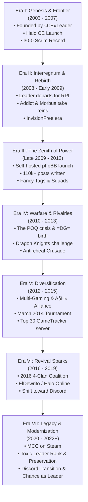

# Combat Experts Clan (`=CE=`) — Comprehensive Chronicle & History (2003 – 2022)

> **Motto:** *"Strength. Determination. Merciless. Forever."*  
> **Primary Arena:** *Halo: Combat Evolved*, *Halo Custom Edition*, *Halo 2 Vista*, *ElDewrito*, *Halo: The Master Chief Collection*  
> **Archival Scope:** Fall 2003 through January 2022 & The Discord Era  
> **Source Material:** Public historical archives, official community records, board logs, member documentaries (*combate1_php1.sql*), and the official Clan Charter (*charter.md*)  
> **Privacy Note:** In strict compliance with historical ethics and clan privacy standards, this document contains **zero** private communications and no personal real-world identities. All chronicles are drawn exclusively from public records, official clan broadcasts, documentaries, community forums, and public clan documents.

---

```text
       ██████╗ ██████╗ ███╗   ███╗██████╗  █████╗ ████████╗    ███████╗██╗  ██╗██████╗ ███████╗██████╗ ████████╗███████╗
      ██╔════╝██╔═══██╗████╗ ████║██╔══██╗██╔══██╗╚══██╔══╝    ██╔════╝╚██╗██╔╝██╔══██╗██╔════╝██╔══██╗╚══██╔══╝██╔════╝
      ██║     ██║   ██║██╔████╔██║██████╔╝███████║   ██║       █████╗   ╚███╔╝ ██████╔╝█████╗  ██████╔╝   ██║   ███████╗
      ██║     ██║   ██║██║╚██╔╝██║██╔══██╗██╔══██║   ██║       ██╔══╝   ██╔██╗ ██╔═══╝ ██╔══╝  ██╔══██╗   ██║   ╚════██║
      ╚██████╗╚██████╔╝██║ ╚═╝ ██║██████╔╝██║  ██║   ██║       ███████╗██╔╝ ██╗██║     ███████╗██║  ██║   ██║   ███████║
       ╚═════╝ ╚═════╝ ╚═╝     ╚═╝╚═════╝ ╚═╝  ╚═╝   ╚═╝       ╚══════╝╚═╝  ╚═╝╚═╝     ╚══════╝╚═╝  ╚═╝   ╚═╝   ╚══════╝
                                    = C E =   C L A N   C H R O N I C L E S   ( 2 0 0 3  -  2 0 2 2 )
```

---

## Table of Contents
1. [Executive Historical Summary](#1-executive-historical-summary)
2. [Chronological Era Timeline (2003 – 2022)](#2-chronological-era-timeline-2003--2022)
   - [Era I: The Genesis & The Golden Frontier (Fall 2003 – 2007)](#era-i-the-genesis--the-golden-frontier-fall-2003--2007)
   - [Era II: The Interregnum & The Rebirth (2008 – Mid 2009)](#era-ii-the-interregnum--the-rebirth-2008--mid-2009)
   - [Era III: The Sovereign Forum Era & The Zenith of Power (Late 2009 – 2012)](#era-iii-the-sovereign-forum-era--the-zenith-of-power-late-2009--2012)
   - [Era IV: Warfare, Scrims, Dramas & Rivalries (2010 – 2013)](#era-iv-warfare-scrims-dramas--rivalries-2010--2013)
   - [Era V: Diversification, Migration & Maturation (2012 – 2015)](#era-v-diversification-migration--maturation-2012--2015)
   - [Era VI: The Revival Sparks & The Twilight of Web Forums (2016 – 2019)](#era-vi-the-revival-sparks--the-twilight-of-web-forums-2016--2019)
   - [Era VII: Pandemic Reunion, Modernization & The Eternal Legacy (2020 – 2022)](#era-vii-pandemic-reunion-modernization--the-eternal-legacy-2020--2022)
   - [The Post-Website Era: Discord Migration, Modern Governance & Leadership](#the-post-website-era-discord-migration-modern-governance--leadership)
3. [The Organizational Matrix: Hierarchy, Tags & Squads](#3-the-organizational-matrix-hierarchy-tags--squads)
   - [The Tag Hierarchy](#the-tag-hierarchy)
   - [Military Ranks & The Revered Hall](#military-ranks--the-revered-hall)
   - [The Dual Roster Framework: Classical Military Hierarchy vs. Modern Discord Charter](#the-dual-roster-framework-classical-military-hierarchy-vs-modern-discord-charter)
   - [Specialized Squads](#specialized-squads)
   - [The Cadet Branch: Combat Experts Cadets (`=CEC=`)](#the-cadet-branch-combat-experts-cadets-cec)
4. [Pivotal Figures & Hall of Fame Biographies](#4-pivotal-figures--hall-of-fame-biographies)
   - [Founders, Supreme Commanders & High Command (Captains, Majors, Colonels, Generals & Revered)](#founders-supreme-commanders--high-command)
   - [The Revered Hall of Fame Elders](#the-revered-hall-of-fame-elders)
   - [The Officer Corps: Lieutenants & Modern Officers](#the-officer-corps-lieutenants--modern-officers)
5. [The Server Bastions & Legendary Battlegrounds](#5-the-server-bastions--legendary-battlegrounds)
6. [Clan Culture, Traditions & Memorable Lore](#6-clan-culture-traditions--memorable-lore)
7. [Epilogue: The 20-Year Legacy](#7-epilogue-the-20-year-legacy)

---

## 1. Executive Historical Summary

The **Combat Experts Clan** (`=CE=`) stands as one of the longest-running, most structured, and culturally resilient gaming institutions in competitive PC history. Born in the autumn of 2003 with the launch of *Halo: Combat Evolved* on PC, `=CE=` survived the entire arc of early 2000s internet gaming: from raw IP firewall routing and primitive dedicated servers, through the golden age of *Halo Custom Edition* map modding, the height of mid-2000s clan warfare, the rise and decline of independent phpBB community forums, to the modern revival across *ElDewrito*, Steam's *Halo: The Master Chief Collection*, and Discord.

Over its nineteen active years recorded in the web archives and its continued presence in the Discord era, `=CE=` was defined by:
- An **undefeated competitive record** in early clan wars (30 multi-map matches, 0 defeats).
- Military-grade organizational discipline, complete with strict promotional criteria, anti-cheat surveillance, and detailed logging.
- An artistic and technical output spanning custom Halo maps, competitive montages, graphics suites, podcasts, and server automation tools.
- A profound bond of brotherhood that saw teenage gamers grow into engineers, architects, soldiers, programmers, and leaders, keeping their community alive across two decades.

---

## 2. Chronological Era Timeline (2003 – 2022)



---

### Era I: The Genesis & The Golden Frontier (Fall 2003 – 2007)

When Bungie and Gearbox Software released *Halo: Combat Evolved* for Windows PC in September 2003, online gaming was still on the wild frontier of the internet. Dedicated servers were practically nonexistent, consumer routers lacked automated port forwarding, and Windows XP firewalls routinely blocked server hosting.

In the autumn of 2003, an engineer-minded gamer named **«CE»Leader** founded the **Combat Experts Clan** (`=CE=`). Refusing to accept peer-to-peer latency, Leader reverse-engineered packet traversal through Linksys hardware and Windows firewalls, successfully creating one of the earliest public dedicated servers in the entire Halo PC community. Leader subsequently codified this knowledge into an authoritative community manual, *"How To Setup a Halo Dedicated Server"*, distributing it freely across the internet and laying the foundational architecture for competitive PC Halo.

```text
"Clan creation date was fall of 2003… Halo had just come out and we were all hardcore junkies 
(true addicts... lol). I figured out how to break through the Linksys and Windows firewalls 
(at that time knowledge on this was short) and was able to setup one of the first public 
Halo servers... To my best knowledge, =CE= is possibly the longest running clan on the planet."
— «CE»Leader, Historical Archival Letter (preserved in Topic #56)
```

In May 2004, Gearbox released *Halo Custom Edition* (Halo CE), unlocking custom map creation and modification tools (HEK). Recognizing that standard Halo would eventually grow stale, «CE»Leader led the entire clan into Custom Edition. `=CE=` did not merely play on custom maps—they built them. «CE»Leader and officer **«CE»BIGBOOM** mastered the editing tools, releasing custom maps that achieved widespread circulation on *halomaps.org*. During this pioneering period, «CE»Leader established direct dialogue with **Tiamat**, the celebrated creator of *Coldsnap* and *Hugeass*, forging a creative ethos within `=CE=` centered around large-scale vehicle and tactical warfare.

During this initial era, `=CE=` operated with military-style preparation. «CE»Leader and his right-hand man, **=CE=Falcon** (his neighbor and best friend, who later enlisted in the U.S. Army Rangers), developed an exhaustive tactical operational doctrine:
- **Topographical Cartography:** Leader and Falcon spent dozens of hours wandering empty maps, mapping coordinate grids, lines of sight, ambush positions, weapon drops, and vehicle respawn timings.
- **Role Specialization:** Combatants were formally segregated into **"Static"** operators (designated snipers, heavy ordnance overseers, counter-snipers) and **"Dynamic"** operators (flag runners, vehicle assault crews, rapid-response flankers).
- **Vehicle Counters:** Specific weapon protocols were codified (such as deploying Longsword tactical airstrikes from vertical angles to neutralize heavy Mythos tanks).

This level of tactical discipline gave `=CE=` an unprecedented competitive record: **they fought approximately 30 multi-map, three-round clan wars and never lost a single match.** At its peak during this period, clan membership fluctuated between 150 and 300 active players, cycling annually with the school calendar (surging in autumn, peaking in December/January, and cooling off in midsummer). An early strategic alliance was forged during these years with **{IB} Infernal Blaze**, cemented by mutual respect between «CE»Leader and {IB} Inferno.

---

### Era II: The Interregnum & The Rebirth (2008 – Mid 2009)

In late 2007 / early 2008, the founding era came to an unexpected halt. «CE»Leader was accepted into one of the world's most prestigious electrical engineering institutions—the Electric Power Engineering program at Rensselaer Polytechnic Institute (RPI). Facing grueling academic demands, Leader made the difficult decision to abruptly step away from gaming, shutting down the original clan operations virtually overnight. Falcon transitioned into the Army Rangers, and the clan seemed destined to become a legend of early Halo.

However, the spirit of `=CE=` refused to die. A core cadre of loyal members, led by **«CE»Addict** alongside veteran **Morbus**, resolved to resurrect the clan. Recognizing the legacy they inherited, Addict contacted «CE»Leader to seek his blessing. Leader formally passed the torch, commending Addict's honor, tactical acumen, and preservation of the original clan aura.

In 2008, Addict established a new community hub on **InvisionFree** (`z15.invisionfree.com/Combat_Experts_Clan`). They recruited fresh talent to rebuild the roster:
- A second recruit using the handle **=CE=Falcon** arrived (coincidentally sharing the callsign of Leader's original companion).
- **`SpAz!` (Ninja)** and **Ichigo** joined the vanguard.
- Crucially, Ichigo scouted and recruited a vibrant player named **=CE= Plague**, who would go on to become the single most prolific poster and daily conversational anchor in the clan's history.

On **May 9, 2009**, the reformed clan structure was formally codified, marking the official anniversary date celebrated by the second-generation brotherhood.

---

### Era III: The Sovereign Forum Era & The Zenith of Power (Late 2009 – 2012)

By late 2009, InvisionFree's hosted service proved too limited for the clan's expanding ambitions. Under the technical leadership of **«CE»Addict**, **=CE=Toxic**, **«CE»Chance**, **Ithiane (Aegisdragon)**, and **=CE=Alteran (Lantean)**, the clan acquired its own domain and launched an independent, self-hosted phpBB 3 community platform: `combatexpertsclan.com`.

The transition on **December 18, 2009** unleashed an explosion of community activity. Within seven days of launch, members generated 1,469 posts. By the end of 2010, the community had authored **79,305 posts in a single calendar year**, followed by **34,665 posts in 2011**, creating a vibrant digital home of over 143,000 public contributions.

```text
┌────────────────────────────────────────────────────────┐
│             ANNUAL FORUM ACTIVITY MATRIX               │
├──────────────┬────────────────────────┬────────────────┤
│    Year      │      Public Posts      │  Era Dynamic   │
├──────────────┼────────────────────────┼────────────────┤
│ 2009 (Dec)   │         2,502          │ Board Launch   │
│ 2010         │        79,305          │ Golden Peak    │
│ 2011         │        34,665          │ High Stability │
│ 2012         │        17,029          │ Multi-Gaming   │
│ 2013         │         7,019          │ Mature Cadre   │
│ 2014         │         1,418          │ Real-Life Shift│
│ 2015         │           821          │ Server Focus   │
│ 2016 – 2019  │           416          │ ElDewrito Era  │
│ 2020 – 2022  │            74          │ MCC & Legacy   │
└──────────────┴────────────────────────┴────────────────┘
```

This era was characterized by an elaborate military organizational structure. The community introduced distinct, prestigious symbols of leadership:
- **The Fancy Tags (`«CE»`):** Reserved exclusively for members of Leader rank—the highest honor achievable in the clan. Leaders bearing fancy tags during this era included `«CE»Addict`, `«CE»Thorn`, `«CE»eden`, `«CE»Chance`, `«CE»Music`, and `«CE»Fuyuri`.
- **The Standard Tags (`=CE=`):** Worn proudly by fully inducted active combatants from Private to General.
- **The Cadet Tags (`≈CE≈` / `-CE-`):** Assigned to recruits undergoing training in the cadet program (`=CEC=`).

To keep operations running smoothly, `=CE=` instituted specialized squads:
1. **The RCON Squad:** High-integrity server administrators entrusted with remote server console passwords. They were bound by strict documentation rules, mandating that every kick, ban, or warning be recorded with photographic or cryptographic hash evidence in the dedicated **Documentaries** archive (Forum 66).
2. **The Graphics Squad:** Headed by artists such as `«CE»Thorn` (an architectural CAD designer), `=CE=Drake`, and `=CE=Birdy`, this squad produced custom signature tags, rank insignia, userbars, and desktop wallpapers.
3. **The Scrim & Combat Squad:** Managed by `«CE»Music`, `Rampage`, and `«CE»Addict`, responsible for vetting competitive rosters, scouting opposing clans, and organizing scrimmages.
4. **The Event & Podcast Squad:** Producers of the official `=CE= Podcast` and organizers of seasonal community tournaments (such as the *Holiday Hangover Event*, *Halloween Custom Map Bash*, and tryout mixxers).

---

### Era IV: Warfare, Scrims, Dramas & Rivalries (2010 – 2013)

The high visibility of `=CE=` dedicated servers made the clan a central player in community diplomacy, intense rivalries, and external conflicts.

#### 1. The POQ Exodus & The Genesis of =DG= (Early 2010)
In February 2010, internal conflicts erupted in the neighboring `POQ` clan. High-ranking POQ server host **POQbum** made the controversial decision to leave his clan and apply to `=CE=`. The move triggered gossip and tension across the Halo community.

`=CE=` leadership demonstrated exemplary maturity:
- On February 24, 2010, officer **Angel** and admin **Phantom** issued an official decree (*Topic #1251: "=CE= and POQ Drama All READ"*), ordering all `=CE=` members to cease gossip, treat POQbum strictly as a standard recruit, and respect POQ's sovereignty.
- POQbum integrated smoothly, bringing high-performance dedicated server infrastructure into `=CE=`.
- In July 2010, POQbum launched a sister clan initiative named **=DG= (Dark Guardians)** (Topic #3279), reviving the historic namesake on `DGclan.com` while maintaining shared servers with `=CE=`. When POQbum briefly stepped back, players like `=CE=Birdy` found refuge in `=CE=`'s open doors.

#### 2. The Complex =DG= Alliance: Brothers, Rivals & Mixed Blood
For over half a decade, `=DG=` served as `=CE=`'s most intricate alliance:
- **The Dual-Citizen Roster:** Numerous players held dual status or transitioned between both clans (notably `=CE=Exeon`, who served as an Admiral in `=DG=` while holding Sergeant rank in `=CE=`).
- **The "Who Would Win?" Debate (Topic #6556):** In January 2011, a 96-reply community debate ignited over whether `=CE=` or `=DG=` would prevail in a full-scale scrimmage. `=CE= Plague` famously declared that *"the power of both clans ends up destroying the universe and we end up in a draw."*
- **Joint Mixxers & Server Ties:** The two clans co-hosted numerous community events and shared admin privileges across mutual servers.
- **The 2015 Friction & Reconciliation:** In June 2015 (Topic #12808), during an unexpected `=CE=` forum outage, `=DG=` temporarily removed `=CE=` from their official ally roster citing perceived inactivity. Stalwarts `=CE=xZy`, `=CE=UGoBoom`, and `=CE=Shy` rallied the council to reassert `=CE=`'s enduring presence, reaffirming the unbreakable historical tie between the two clans.

#### 3. Scrimmage Showdowns: The Dragon Knights `{DK}` Affair
Between 2010 and 2012, dozens of clans issued formal scrimmage challenges to `=CE=` via the challenge registry (Forums 79 and 80), including `Team Rebellion`, `TeamMods (=TM=)`, `Clan Delta`, `»SG«`, `RIOT`, and `{DK} Dragon Knights`.

The most memorable confrontation occurred in March–April 2011 with `{DK}`:
- {DK} leader Ammar issued an urgent 6v6 challenge on Blood Gulch (Snipers, no shields, Warthogs only).
- `=CE=` noticed that {DK} had cloned their website styling and layout.
- An extensive scheduling effort ensued, managed by `«CE»Music`, `Rampage`, and `Plague`, complicated by a grueling 10-hour timezone difference between North America and the Middle East.
- On Saturday, April 23, 2011, the `=CE=` strike team (`Music`, `Blank`, `Hell`, `Tickle`, with `Addict` and `Plague` in reserve) assembled on the match server. After granting a 15-minute grace period, {DK} failed to appear, resulting in an official forfeit victory for `=CE=`.

#### 4. The Anti-Cheat Crusade & Imposter Wars
Because `=CE=` hosted the most populated public servers in Halo CE (including *Coldsnap*, *Ambush*, *FTLoBG*, and *Zombies*), they were constantly targeted by malicious actors:
- **Aimbotters & Wallhackers:** The RCON squad mounted a forensic campaign against notorious repeat cheaters (such as the tracking and unmasking of wallhackers like *Grimcall* and botters like *jesusJMF* and *kris_kof_df*).
- **The Hash-Ban Doctrine:** Rather than issuing arbitrary IP bans (which could be bypassed via dynamic IP resets), administrators were trained to extract and record unique CD-key cryptographic hashes, banning offenders permanently from all `=CE=` infrastructure.
- **Imposters:** Cheaters frequently masqueraded under clan tags (such as fake `=CE= tOx!C` and imposter leader handles). The RCON team maintained a zero-tolerance policy, deploying administrative scripts and spectator verification before taking swift action.

---

### Era V: Diversification, Migration & Maturation (2012 – 2015)

By 2012, the PC gaming ecosystem had broadened significantly. While Halo Custom Edition remained the spiritual bedrock of the clan, members actively branched out into contemporary titles. Dedicated squads were mobilized for *Team Fortress 2*, *Call of Duty: Modern Warfare 2*, *Garry's Mod*, *Minecraft* (with custom clan server builds), and *Planetside 2*, while competitive teams tested the waters in *Halo 2 Vista*.

During this era, a vital sister alliance formed with the **`A§H»` Clan (The A§H Clan, theASHclan.org)**, established around 2012 by **Crash** and **SONOR** (after BMF inspired Sonor, Sonor reached out to Crash, and the two co-founded the clan with Crash serving as its primary founder and guiding leader). Rapidly gaining acclaim for their well-moderated dedicated servers, `A§H»` became a close companion community to `=CE=`. Strong friendships crossed between the two rosters, with players like **`=DG=Enzo`**, **`Mandalor` (formerly `sHiNe!`)**, **`Voltagen`**, and former `=CE=` veteran **`=CE=Greed`** (`br0wnbr0th4`) sharing active ties across both clans.

This alliance culminated in an epic event in March 2014 (Topic #12394), when `A§H»Killer` (former `FoV` Hitman) proposed a multi-mode friendly tournament between `=CE=` and `A§H»` across both clans' servers. Featuring an intricate bracket scoring system (1 point per CTF capture, 1 point per Slayer kill, 5 points for the last survivor in Zombies, up to 75 points max), the tournament brought together `A§H»Killer`, `Mandalor`, `Enzo`, `Willrok`, `Voltagen`, and `Runriot` against `=CE=`'s `«CE»Addict`, `=CE=Giuli`, `=CE=Shy`, `=CE=Warthog`, and `=CE= Pydro`. The event highlighted the warm sportsmanship and mutual respect that carried both communities forward.

Simultaneously, the Biographies project launched in November 2012 by `«CE»Fuyuri` (Forum 104) captured a poignant transition: the adolescent recruits of 2008–2010 were graduating from high school and university, entering careers, and navigating adult milestones. `«CE»Thorn` was advancing in architecture and CAD design in Australia; `«CE»Chance` was pursuing software engineering at the University of West Florida; `«CE»Fuyuri` was building an IT career in New Zealand; `=CE=Ground` was rising from a high school freshman to Colonel while pursuing computer engineering; `=CE=Exeon` was balancing astrophysics studies at UCL with work at BAE Systems; `=CE=Four` (Inferno) was balancing full-time work and college prep in Ohio, rising to Captain twice; and `=CE=Durelle` was working in web infrastructure in Canada while maintaining his legendary sniping reputation (*"Durelle.exe"*).

Despite the aging of Halo CE's master browser, `=CE=`'s technical staff maintained exceptional round-the-clock stability. In late October 2015 (Topic #12841), `«CE»Addict`, `=CE=Shy`, and `=CE=UGoBoom` celebrated a historic milestone: **a `=CE=` dedicated Halo server achieved a Top 30 global rank on GameTracker**—a full twelve years after the clan's founding.

---

### Era VI: The Revival Sparks & The Twilight of Web Forums (2016 – 2019)

By early 2016, physical retail copies of Halo PC were long out of print, and online lobby populations were dwindling worldwide. Recognizing the threat to classic PC Halo, `A§H` diplomat and leader **Crash** approached `«CE»Addict` and clan leadership in January 2016 (Topic #12881) with a historic proposal: forming a formal "United Nations" coalition among the four enduring pillar clans—**`=CE=`**, **`=DG=`**, **`A§H»`**, and **`«RG»`**. Crash proposed pooling active player bases across joint dedicated servers, sharing real-time anti-cheat intelligence against aimbotters and hash-banned cheats, and coordinating joint cross-clan events. `«CE»Addict`, `«CE»Chance`, and `«CE»Thorn` entered diplomatic talks, establishing foundational **Autonomy** and **Sustainability** clauses to guarantee each clan's sovereign independence. The resulting four-clan summit, convened in `=DG=`'s Discord in February 2016, created a vital mutual support pact that sustained the remaining veteran communities through the twilight of the standalone game.

Shortly thereafter, between 2016 and 2018, the PC Halo community experienced an electric resurgence through **ElDewrito** (Halo Online). For `=CE=`, this was a spiritual homecoming. The clan established Forum 108 (*ElDewrito*), organizing community game nights where veterans and newcomers relived classic Halo 3-style multiplayer with modern PC mouse-and-keyboard precision.

As the decade drew to a close, modern voice and text platforms permanently supplanted traditional web bulletin boards across gaming culture. While forum post frequency tapered off, the brotherhood did not dissolve; it migrated. The official `=CE=` Discord server became the primary daily headquarters for voice lobbies, banter, gaming sessions, and life updates, while the web forum was lovingly preserved as a sacred monument of the clan's golden years.

---

### Era VII: Pandemic Reunion, Modernization & The Eternal Legacy (2020 – 2022)

When global lockdowns took effect in the spring of 2020, veterans who had not logged into the website in years returned to check on their brothers. Threads were revived with roll calls as `~CE~Trael`, `=CE=Giuli`, `Cactuar`, `=CE=Alteran`, and `«CE»Addict` checked in, counting posts and sharing well-wishes. Members reassembled on PC to squad up in *Halo: The Master Chief Collection (MCC)* on Steam, bringing the journey full circle back to the classic Master Chief campaigns and multiplayer lobbies.

On July 19, 2020, **=CE=Toxic** issued a historic call to arms:
```text
"I hope that everyone is staying safe during these times! 
We are in need of contributors to the new website project. Anyone with project management, 
coding, testing, database maintenance, systems administration, graphic design, or community 
management experience is welcomed and encouraged to help out in any way that they can... 
The point of contact is =CE=Toxic."
— =CE=Toxic, Public Announcement
```
This initiative spearheaded the complete modernization of the clan's legacy codebase—transitioning nineteen years of history into secure, containerized, modern architectures so that the records of `=CE=` would never be lost to time.

On May 27, 2021, clan patriarch **«CE»Addict** made a momentous announcement to the community (Topic #13253):

```text
"Over the years =CE=Toxic has been an outstanding member. =CE=Toxic really has been a major 
ingredient of the glue that keeps us together over the last 12+ years. The list of his 
contributions is very long and I am very proud to announce that we have a new Fancy Tag. 
Thank you «CE»Toxic for everything."
— «CE»Addict, Official Leadership Proclamation
```
After twelve years of tireless administrative stewardship, technical leadership, and unwavering loyalty, =CE=Toxic was officially invested with the coveted chevron **Fancy Tags** and elevated to the rank of **Leader (`«CE»Toxic`)**. While holding Leader rank and serving as the administrative anchor of the clan, Toxic maintained the community's foundational systems, while **«CE»Chance** stood as **the Leader** of the clan.

The final recorded post in the historic forum database occurred on **January 14, 2022**, in a reflective discussion with `=DG=Morgan` titled *"What killed all the forums in the world (almost all)?"*.

`«CE»Toxic` provided the poetic closing words for an entire epoch of digital culture:
```text
"Definitely a change in the way that people use the internet. The rise of real-time 
communications and social networks has shifted the ways that we communicate online... 
This however, does not foster conversations, and I think that is why the spirit of 
forums lives on in the form of other platforms similar to Reddit, Facebook Groups, 
and others.

I always loved logging onto the forums in the morning while sipping a freshly-brewed coffee, 
and checking the unread posts."
— «CE»Toxic, Final Archival Post
```

---

### The Post-Website Era: Discord Migration, Modern Governance & Leadership

Following the conclusion of the forum's active history in early 2022, the clan completed its final platform evolution, transitioning from an archival web-based forum into a modern real-time gaming community:

- **Decommissioning the Website:** With gaming culture and clan operations shifting permanently to modern real-time platforms, the historic phpBB community site was formally retired and shut down, with its nineteen years of records carefully preserved in secure, containerized archives.
- **The Discord Hearth:** All primary operations—daily communications, voice lobbies, event planning, and cross-game matchmaking—permanently transitioned to the official **=CE= Discord** server, which serves as the active headquarters of the clan today.
- **The Modern Clan Charter (c. 2022):** Rather than allowing clan standards to erode with the loss of traditional forum boards, leadership codified the official **Clan Charter** to govern the new Discord era. This constitution adapted `=CE=`'s military heritage to accommodate the realities of an adult membership:
  - *Streamlined Recruitment & Observation:* Aspiring Spartans apply directly within dedicated Discord channels or during live events attended by an Officer. Accepted applicants receive the historic probationary `-CE-` tag and the Member Discord role. Over an active one-week observation period, the community reviews their demeanor; if conduct remains honorable and no objections are raised, the dashes are dropped and the recruit is awarded the full `=CE=` tags.
  - *Member Autonomy & Interest Groups:* Recognizing that veterans now balance careers, families, and adult responsibilities, rigid forum activity quotas were formally abolished. Full members participate at their leisure and are encouraged to form and join specialized interest Groups.
  - *A Proportional Officer Corps:* The Officer corps was reorganized on a proportional ratio relative to total clan size. Candidates are nominated by peers based on merit and passion for leadership, confirmed by vote. To maintain an active leadership pulse, Officers are expected to attend at least one clan event or contribute on Discord monthly.
  - *Decentralized Server Stewardship:* Centralized administrative rosters were replaced with decentralized community hosting. Members who host servers for the clan administrate at their leisure under clan guidelines, ensuring `=CE=` servers remain welcoming and cheat-free without bureaucratic overhead.
- **«CE»Chance as Leader:** With the sunset of the website, clan patriarch **«CE»Addict** formally designated **«CE»Chance as the Leader of the Combat Experts Clan**. A foundational pillar of reason, intellect, and leadership since May 9, 2009, Chance helms the modern Discord era, guiding `=CE=` into the future alongside `«CE»Addict` and `«CE»Toxic` (Leader rank).
- **The Modern Active Roster (The Discord Era):** Under the governance of the modern charter, the active roster reflects both the ancestral leadership that carried the clan across two decades and the frontline vanguard maintaining day-to-day operations:
  - **The Leader Council (`«CE»` — Fancy Tags):**
    - `«CE»Chance` — **The Leader of the Combat Experts Clan**; supreme coordinator and intellectual director.
    - `«CE»Addict` — Patriarch, Rebuilder, and General.
    - `«CE»Thorn` (Lord Thorn) — Architectural visionary and aesthetic architect.
    - `«CE»eden419` (`«CE»eden` / Grif) — Beloved cultural pillar and morale commander.
    - `«CE»Fuyuri` — Master Chronicler and community organizer.
    - `«CE»Toxic` — Technical cornerstone, 2x Major, Leader rank, and infrastructural architect.
  - **The Active Officer Corps (`=CE=` — Standard Tags):**
    - `=CE= Chris` — Tryout administrator and veteran event coordinator.
    - `=CE= FrightfulFerno` (`=CE=Ferno` / Inferno / Four) — Double Captain and frontline marksman.
    - `=CE=ÅltyFox` (`=CE=Alteran` / Lantean) — Security sentinel, server protector, and bot engineer.
    - `=CE=Birdy` — British bastion, server administrator, and graphics artisan.
    - `=CE=Durelle` — Legendary Canadian marksman (*"Durelle.exe"*).
    - `=CE=Greed` (`slowgreed`, formerly `br0wnbr0th4`) — Tactical veteran and diplomatic bridge with A§H.
    - `=CE=M¡√£Ŧ` (Mijet) — Application squad veteran and steadfast community steward.
    - `=CE=UGoBoom` — Dedicated RCON enforcer and server guardian.
    - `=CE=Warthog` — Longtime combat veteran, map builder, and 2014 tournament competitor.
    - `=CE= Discord Bot` (`AltyBot#4373`) — Automated infrastructure bot developed by `=CE=ÅltyFox` to maintain Discord services.

---

## 3. The Organizational Matrix: Hierarchy, Tags & Squads

### The Tag Hierarchy
A member's tags in game and on the forums conveyed their sacred standing within the clan:

| Tag Format | Designation | Description & Qualifications |
| :--- | :--- | :--- |
| **`«CE»Username`** | **The Fancy Tag** | **Leader Rank & Supreme Council.** Reserved for members holding the rank of Leader who governed clan policy, finance, server infrastructure, and strategic diplomacy. |
| **`=CE=Username`** | **Standard Tag** | **Full Clan Member.** Awarded to initiated Spartans from Private First Class through General who had passed tryouts, application votes, and background hash checks. |
| **`≈CE≈Username`** | **Cadet Tag** | **Combat Experts Cadets (`=CEC=`).** Worn by junior recruits and cadet officers undergoing formal training and behavioral evaluation. |
| **`-CE-Username`** | **Probationary / Recruit** | Worn by new applicants and recruits during their initial probationary evaluation period. |

---

### Military Ranks & The Revered Hall

```text
               ┌────────────────────────────────────────────────────────┐
               │              THE COMBAT EXPERTS HIERARCHY              │
               ├────────────────────────────────────────────────────────┤
               │   SUPREME COMMAND   : «CE» Leadership (Fancy Tags)     │
               │   HIGH COMMAND      : General, Colonel, Major          │
               │   OFFICER CORPS     : Captain, Lieutenant              │
               │   NON-COMMISSIONED  : Sergeant, Specialist             │
               │   ENLISTED RANKS    : Private First Class, Private     │
               │   PROBATIONARY      : Recruit, Cadet (≈CE≈)            │
               ├────────────────────────────────────────────────────────┤
               │   THE REVERED HALL  : Legendary Retired Elders         │
               └────────────────────────────────────────────────────────┘
```

#### The Revered Group (Group #40)
The highest honor bestowed upon a veteran departing active duty. Defined officially in clan law as:  
> *"This group consists of people that are former members of =CE= that contributed something of worth towards =CE=."*

---

### The Dual Roster Framework: Classical Military Hierarchy vs. Modern Discord Charter

Throughout its history, `=CE=` maintained two distinct organizational models: the **Classical Military Hierarchy** that governed the sovereign forum era (2003–2021) and the **Modern Charter Matrix** that governs the Discord era (2022–Present).

#### 1. The Classical Military Hierarchy (2003 – 2021)
During the sovereign website epoch, promotion was earned through forum post milestones, scrimmage victories, server administration hours, and peer votes across nine military grades:

| Echelon | Military Grade | Requirements & Scope |
| :--- | :--- | :--- |
| **Supreme Council** | **Leader (`«CE»`)** | Supreme executive authority, fancy tags, board administration, diplomatic treaties. |
| **High Command** | **General (`=CE=`)** | Patriarchal oversight, highest military grade, command of entire combat roster. |
| | **Colonel (`=CE=`)** | Senior commanders overseeing multiple squads, server clusters, and disciplinary appeals. |
| | **Major (`=CE=`)** | Strategic leaders directing specialized divisions (RCON, Scrim, Graphics, Cadets). |
| **Officer Corps** | **Captain (`=CE=`)** | Senior field commanders, server administrators, tryout evaluators, and forum moderators. |
| | **Lieutenant (`=CE=`)** | Junior officers, tryout judges, squad second-in-commands, and RCON operators. |
| **Non-Commissioned** | **Sergeant (`=CE=`)** | Seasoned combatants, forum anchors, match reserves, and cadet trainers. |
| | **Specialist (`=CE=`)** | Dedicated technical, artistic, or operational contributors. |
| **Enlisted Ranks** | **Private First Class (`=CE=`)** | Active Spartans who completed initial combat probation. |
| | **Private (`=CE=`)** | Fully inducted members awarded full standard `=CE=` tags. |
| **Probationary** | **Recruit / Cadet (`≈CE≈` / `-CE-`)** | Applicants in tryouts or cadet academy evaluation. |

#### 2. The Modern Charter Matrix (2022 – Present)
Adopted with the retirement of web forums, the modern charter instituted a streamlined structure suited to an adult brotherhood balancing careers and gaming:

```text
┌────────────────────────────────────────────────────────────────────────┐
│                      MODERN DISCORD CHARTER ROLES                      │
├───────────────────┬─────────────┬──────────────────────────────────────┤
│ Discord Role      │ Tag Format  │ Responsibilities & Standing          │
├───────────────────┼─────────────┼──────────────────────────────────────┤
│ Leader            │ «CE»        │ Executive guidance, fancy tags.      │
│                   │             │ Elected by Leaders; monthly presence.│
│                   │             │ «CE»Chance serves as The Leader.     │
├───────────────────┼─────────────┼──────────────────────────────────────┤
│ Officer           │ =CE=        │ Operational stewardship.             │
│                   │             │ Nominated on merit; voted by peers.  │
│                   │             │ Monthly Discord/event participation. │
├───────────────────┼─────────────┼──────────────────────────────────────┤
│ Member            │ =CE=        │ Full Spartans. Leisure participation.│
│                   │             │ Access to interest Groups.           │
├───────────────────┼─────────────┼──────────────────────────────────────┤
│ Recruit           │ -CE-        │ Probationary status (1-week trial).  │
│                   │             │ Voted to full =CE= upon completion.  │
├───────────────────┼─────────────┼──────────────────────────────────────┤
│ Server Stewards   │ Custom      │ Independent hosters managing servers │
│                   │             │ at their leisure under guidelines.   │
└───────────────────┴─────────────┴──────────────────────────────────────┘
```

---

### Specialized Squads

1. **RCON Squad:** The police force of `=CE=` dedicated servers. Empowered with remote server control passwords, members were bound by strict accountability rules. Abuse of admin powers resulted in immediate stripping of rank.
2. **Graphics Squad:** Created userbars, clan logos, desktop backgrounds, and customized forum avatars. Their artwork gave `=CE=` one of the most distinctive visual signatures in the Halo PC scene.
3. **Mapping Squad:** Continued the proud tradition of «CE»Leader and «CE»BIGBOOM, creating, modifying, and hosting custom multiplayer maps.
4. **Video Squad:** Captured Xfire recordings and edited cinematic frag montages showcasing clan tryouts, scrim victories, and humorous glitch antics for YouTube.
5. **Event & Podcast Squad:** Planned community mixxers and produced the `=CE= Podcast`, discussing clan news, gaming industry trends, and interviews with community personalities.

---

### The Cadet Branch: Combat Experts Cadets (`=CEC=`)
Recognizing that many eager applicants were too young or lacked competitive seasoning for the main roster, `=CE=` established a dedicated feeder academy: **Combat Experts Cadets (`=CEC=`)**.
- Cadets wore the distinctive tilde tags: **`≈CE≈`**.
- They advanced through an independent cadet hierarchy: *Cadet Recruit → Cadet → Cadet Lance Corporal → Cadet Corporal → Cadet Warrant Officer → Officer Cadet*.
- Senior officers served as instructors (such as `«CE»Thorn` and `[TS]` instructors).
- Dedicated training forums (Forums 97, 98, 99, 103) taught server etiquette, anti-cheat detection, teamwork, and marksmanship. Cadets who demonstrated character and loyalty were eventually promoted into full `=CE=` Spartan status.

---


## 4. Pivotal Figures & Hall of Fame Biographies

```text
┌────────────────────────────────────────────────────────────────────────┐
│                      PIVOTAL COMMUNITY FIGURES                         │
└────────────────────────────────────────────────────────────────────────┘
```

### Founders, Supreme Commanders & High Command
*(All members who held the rank of Captain, Major, Colonel, General, or Leader rank)*

#### «CE»Leader (Founding Father & Pioneer, 2003 – 2008)
The visionary who started it all in the fall of 2003. A brilliant technical pioneer who bypassed early Linksys and Windows firewalls to stand up one of the very first dedicated public Halo servers in gaming history. Author of the community's definitive *"How To Setup a Halo Dedicated Server"* guide, co-creator of custom Halo CE maps alongside «CE»BIGBOOM, and tactician who led `=CE=` through an undefeated 30–0 clan war record before departing for Rensselaer Polytechnic Institute (RPI) to study electric power engineering.

#### «CE»Addict (The Patriarch & Rebuilder, General, 2008 – Present)
The indispensable heart and soul of second-generation `=CE=`. When Leader stepped down, Addict stepped into the breach, earned Leader's formal blessing, rebuilt the clan on InvisionFree, and financed and launched the self-hosted phpBB platform in 2009. Holding the rank of General and wearing the coveted Fancy Tags, Addict governed with warmth, fairness, and fierce loyalty, serving as the patriarch of the clan across two decades.

#### «CE»Chance (The Leader, Colonel, 2009 – Present)
Joined on May 9, 2009. A software engineering scholar celebrated for his dry intellect, sharp wit, and deep philosophical musings. A vital administrator and Colonel during the forum era, Chance was formally designated by «CE»Addict as **the Leader of the Combat Experts Clan** as the community moved into its modern Discord era. Chance represents the intellectual anchor and supreme guidance of the clan today.

#### «CE»Thorn (Lord Thorn) (The Architect, Colonel, Leader, 2008 – Present)
One of the most formidable and influential personalities in clan history. An architectural CAD designer from Australia, Thorn was the fastest member in clan history to advance to Colonel, later ascending to full Leader. Known for his razor-sharp wit, architectural precision, and uncompromising standards, Thorn directed the Graphics Squad, commanded the Cadet Academy (`=CEC=`), and designed the visual identity and rank userbars of `=CE=`.

#### «CE»Toxic (The Technical Cornerstone, 2x Major, Leader Rank, 2009 – Present)
Registered on December 13, 2009 (User #53), Toxic served as the bedrock of `=CE=`'s technical infrastructure, server hosting, and security. After initially earning promotion to Major, he resigned his post and later climbed the military ladder a second time, achieving the rare distinction of **2x Major**. Commended by patriarch «CE»Addict as *"the glue that keeps us together,"* Toxic was invested with the chevron Fancy Tags in May 2021, elevating him to Leader rank (`«CE»Toxic`) in recognition of over a decade of administrative stewardship.

#### «CE»eden (Grif / Chewie) (The Beloved Pillar, Major, Leader, 2010 – Present)
Author of 6,212 posts, eden was one of the most dedicated and warm-hearted leaders in clan history. A self-professed *Red vs. Blue* and sci-fi fanatic, eden was beloved across all ranks for his constant presence in servers, his encouragement of recruits, and his steadfast dedication to the community.

#### «CE»Music (The Scrim Commander, Major, Leader, 2009 – Present)
Major and Clan Leader who commanded the Scrim Squad (1,263 posts). Music was the diplomatic and strategic bridge who negotiated clan war parameters, resolved disputes with rival clans, and led the competitive line during the high-stakes matches of 2010–2012.

#### «CE»Fuyuri (The Chronicler & Leader, Major, 2010 – Present)
An IT specialist from New Zealand (2,788 posts). Fuyuri brought boundless energy to the officer corps and was the visionary architect behind the **Clan Biographies (Forum 104)** project, creating a lasting space for members to chronicle their personal lives and aspirations.

#### «CE»Ithiane (Aegisdragon) (Secretary of War, General, 2009 – Present)
General and high administrator (2,748 posts). Renowned across the community as the clan's "Secretary of War," Ithiane wielded the ban hammer with unwavering justice, defended clan servers from raids, and provided high-level administrative governance during the golden era.

#### =CE=Ground (The Poet & Engineer, Colonel, 2009 – Present)
Joined as a high school freshman, grew up within `=CE=`, and rose all the way to Colonel (1,729 posts). A computer engineering scholar with a passion for robotics, AI, progressive rock, and poetry, =CE=Ground epitomized the journey of a young gamer maturing into a scholar among clan brothers.

#### =CE=ÅltyFox (=CE=Alteran / Lantean) (The Sentinel & Bot Architect, Captain, Modern Officer, 2009 – Present)
Author of 4,277 posts. Alteran served as a stalwart Captain, moderator, server guardian, and technical troubleshooter. Fiercely protective of clan standards, Alteran logged countless hours policing servers, managing permissions, and maintaining board security. In the modern Discord era, operating as `=CE=ÅltyFox`, he continues his dedicated service as an active Officer and engineered the clan's automated Discord assistant, `=CE= Discord Bot` (`AltyBot#4373`).

#### =CE=Birdy (The British Bastion, Captain, Modern Officer, 2010 – Present)
British officer and graphics artisan (1,814 posts). Rising to the rank of Captain, Birdy was an essential fixture of both server operations and forum life, known for his humor, reliable administration, and loyalty during the =DG= server transitions. He continues to serve in the modern Discord era as an active Officer.

#### =CE= FrightfulFerno (=CE=Ferno / Inferno / Four) (The Resilient Spartan, 2x Captain, Modern Officer, 2009 – Present)
Joined in April 2009. Overcoming internet outages and personal challenges, Ferno demonstrated extraordinary dedication, rising from PFC to Lieutenant in record time (3 days) and ultimately attaining the rank of Captain on two separate occasions (1,315 posts). In the Discord era, serving under the handle `=CE= FrightfulFerno`, he continues his frontline service as an active Officer.

#### =CE=RedFlag (The High Administrator, Captain, 2009 – Present)
Captain and founding forum administrator (1,139 posts). RedFlag was an essential pillar during the initial setup of `combatexpertsclan.com`, managing backend databases, board permissions, and moderation policies.

#### =CE= Chris (The Event Overseer, Captain, Modern Officer, 2009 – Present)
Captain and administrator (980 posts). Chris served as a key administrative officer, managing tryout servers, executing server resets, and supervising clan tryouts and events. He continues his administrative presence in the modern Discord era as an active Officer.

#### =CE=Durelle (The Unstoppable Sniper, Captain, Modern Officer, 2009 – Present)
Canadian web technician and competitive marksman (538 posts). Rising to Captain and administrator, his lethal sniping precision was so feared that clan mates jokingly accused him of running an automated hack called *"Durelle.exe"*. He remains a cornerstone of the active Officer Corps in the Discord era.
Canadian web technician and competitive marksman (538 posts). Rising to Captain and administrator, his lethal sniping precision was so feared that clan mates jokingly accused him of running an automated hack called *"Durelle.exe"*.

#### =CE=Sagino (The International Guardian, Captain, 2010 – Present)
Captain and server administrator (534 posts). Sagino was a dedicated enforcer on the Ambush server, known for his vigilance against exploiters and his active participation in the RCON Squad documentaries.

---

### The Revered Hall of Fame Elders
*(Members formally inducted into Group #40 for exceptional lifetime contributions, with highest military ranks attained)*

#### =CE= Plague (The Voice of the Clan, Highest Rank: Sergeant, Revered, 2009 – Present)
The undisputed **all-time post champion of `=CE=` with 7,844 posts**. Recruited in 2009 by Ichigo, Plague served as the vibrant heartbeat and social conscience of the community across more than a decade. Holding the rank of Sergeant, Plague anchored *The Spam Forum*, broke down competitive match mechanics in the Scrim Squad, assisted with application voting, and kept daily spirits high with unmatched humor. Plague was universally beloved as the ultimate embodiment of everyday clan camaraderie.

#### «CE»BIGBOOM (The Master Mapmaker, Founding Co-Leader, Revered, 2003 – Present)
Co-commander alongside «CE»Leader during the 2003–2004 founding era. «CE»BIGBOOM was a master level designer whose custom multiplayer creations placed `=CE=` at the center of the global Halo Custom Edition modding scene on *halomaps.org*. Following his early service, he graduated in mechanical engineering from Michigan Tech and returned to the forums across the decades to salute the clan's endurance and celebrate the brotherhood he helped forge.

#### =CE=Falcon (The Original Spartan, Founding High Command, Revered, 2003 – 2008)
«CE»Leader's original neighbor, best friend, and tactical right-hand man. Together with Leader, Falcon co-authored the operational doctrine that powered the clan's undefeated 30–0 clan war record, personally scouting terrain and hand-drawing topographical coordinate maps for team ambushes before enlisting in the U.S. Army Rangers.

#### =CE=Falcon (The Country Spartan / 2nd Falcon, Highest Rank: Private, Revered, 2008 – Present)
Joining during the 2008 InvisionFree rebirth and coincidentally sharing the callsign of the founding era's Falcon, this second Falcon was one of the foundational recruits who rebuilt `=CE=` alongside Addict and Morbus. Known for his authentic country charm, paintball enthusiasm, and steadfast loyalty, his December 2010 return thread ("Back In Black") remains one of the most celebrated homecoming threads in clan history.

#### =CE=Fire (The Moderation Pillar, Highest Rank: Captain / Senior Moderator, Revered, 2009 – Present)
With 3,569 posts, Fire was one of the most dedicated, steady, and respected moderators in clan history. Rising through the officer ranks to Captain and serving as a lead forum moderator, Fire was the voice of calm during turbulent community debates, defusing cross-clan tensions and protecting forum integrity for years.

#### «CE»Angel (The Peacemaker, Highest Rank: Major, Revered, 2009 – Present)
Author of 134 posts. Attaining the rank of Major, Angel played a pivotal diplomatic role in clan history. In February 2010, when external controversy flared over POQbum's departure from POQ to join `=CE=`, Angel authored the official community proclamation (*Topic #1251: "=CE= and POQ Drama All READ"*), establishing a lasting standard of honor, maturity, and non-interference that defined `=CE=` statecraft.

#### «CE»Nuwbz (The Rebirth Vanguard, Highest Rank: Major, Revered, 2009 – Present)
With 1,056 posts, Nuwbz was a foundational pillar of the 2008–2009 InvisionFree rebirth who rose to the rank of Major. Known for his comprehensive member portfolios and deep technical discussions, Nuwbz helped bridge the gap between the founding era and the sovereign forum launch.

#### «CE»Phantom (The Silent Sentinel, Highest Rank: Major, Revered, 2009 – Present)
Author of 627 posts. Attaining the rank of Major, Phantom was an uncompromising administrator and enforcer of clan policy. Partnering with Angel during the 2010 POQ migration, Phantom ensured clan servers maintained strict discipline and zero tolerance for harassment.

#### =CE=Rampage (The Scrim Tactician, Highest Rank: Captain, Revered, 2009 – Present)
Author of 968 posts. Rising to Captain, Rampage commanded the front lines of the Scrim Squad during the peak competitive years of 2010–2012. Rampage led tactical coordination and diplomacy during the high-profile Blood Gulch showdown against Dragon Knights `{DK}`.

#### =CE=Xtreme05 (The Tactical Enforcer, Highest Rank: Captain, Revered, 2009 – Present)
With 747 posts, Xtreme05 attained the rank of Captain. Known for his aggressive competitive drive, Xtreme05 was an enthusiastic participant in clan scrims and server moderation, rallying members with unyielding Spartan pride.

#### =CE=Kradon (The Steadfast Veteran, Highest Rank: Private First Class, Revered, 2009 – Present)
Author of 3,467 posts. Kradon was one of the most iconic fixtures in `=CE=` history. Renowned for his dry wit, daily forum presence, and steadfast loyalty, Kradon remained an active, beloved pillar across every era without ever seeking administrative power.

#### =CE=Blank (Blanket) (The Dedicated Operative, Highest Rank: Sergeant, Revered, 2010 – Present)
Author of 2,129 posts. Rising to Sergeant, Blank was a cornerstone of clan operations, active in the RCON Squad, regular scrim lineups, and community events. His dependability on game servers earned him widespread respect across the entire roster.

#### =CE=Horns (The 4-Time Veteran, Highest Rank: Private First Class, Revered, 2009 – Present)
Author of 1,993 posts. Having served across four separate eras of clan history starting on InvisionFree, Horns was a passionate, outspoken voice whose deep historical memory helped anchor the community during major platform transitions.

#### =CE=Flóòk (The Community Favorite, Highest Rank: Private, Revered, 2010 – Present)
With 1,701 posts, Flóòk was a vibrant forum regular and active server admin, known for his humor, high energy in game lobbies, and vigilant anti-cheat reporting on the Ambush servers.

#### =CE=Exeon (The Astrophysics Vanguard, Highest Rank: Sergeant, Revered, 2010 – Present)
Author of 1,107 posts. Exeon achieved the unique distinction of serving as an Admiral in `=DG=` while holding Sergeant rank in `=CE=`. Balancing studies in astrophysics in London with BAE Systems work, Exeon served as the vital diplomatic bridge between `=CE=` and `=DG=`.

#### =CE=Kilo23 (The Forensic Admin, Highest Rank: Sergeant, Revered, 2009 – Present)
Author of 736 posts. Rising to Sergeant, Kilo23 was an early star of the RCON Squad, famous for producing video recordings and detailed documentary evidence to root out cheaters on Coldsnap.

#### =CE=Cactuar (The Resilient Elder, Highest Rank: Sergeant, Revered, 2009 – Present)
Author of 141 posts. Rising to Sergeant, Cactuar was a respected veteran from the earliest board days who returned faithfully during the 2020 reunion to celebrate community longevity.

#### =CE=`SpAz!` (Ninja) (The Rebirth Vanguard, Highest Rank: Private First Class, Revered, 2010 – Present)
An early recruit from the 2008 InvisionFree rebirth alongside Falcon and Ichigo, celebrated for his energetic personality and early tryout sessions with Addict and Morbus.

#### =CE=Drake (The Visual Artisan, Highest Rank: Specialist, Revered, 2009 – Present)
Author of 85 posts. Rising to Specialist, Drake was an early Graphics Squad leader who designed custom clan signatures, headers, and visual assets during the launch of the sovereign website.

#### =CE=Cowboy (Lucky 7) (The Presidential Wit, Highest Rank: Recruit, Revered, 2009 – Present)
Author of 49 posts. A colorful personality celebrated for his humorous "presidential addresses" and anniversary reflections commemorating life in `=CE=`.

---

### The Officer Corps: Lieutenants & Modern Officers
*(Members who attained the rank of Lieutenant in the classical hierarchy, alongside newly appointed Officers in the modern Discord Charter)*

#### =CE=Shy (Lieutenant, 2010 – Present)
With 2,077 posts, Shy was an indispensable international member from Lahore, Pakistan. Promoted to Lieutenant, Shy was an elite marksman, active tryout judge, and co-manager of the dedicated server that reached the global Top 30 on GameTracker in 2015.

#### =CE=Tesla (Lieutenant, 2010 – Present)
Author of 1,043 posts. Tesla was an active, highly respected officer who contributed extensively to community discussions, server administration, and tactical squads.

#### =CE=UGoBoom (Lieutenant, Modern Officer, 2009 – Present)
Author of 550 posts. UGoBoom was one of the clan's most dedicated RCON enforcers, maintaining meticulous documentary logs and protecting the Ambush and FTLoBG servers from griefers and cheaters. In the modern Discord era, UGoBoom continues his steadfast leadership as an active Officer.

#### =CE=Ichigo (Lieutenant, 2010 – Present)
Author of 385 posts. Ichigo was a vital recruiter during the 2008–2009 rebuilding era, famously bringing future post champion `=CE= Plague` into the clan and rising to Lieutenant.

#### =CE=fade' (Penguin) (Lieutenant, 2011 – Present)
Author of 188 posts. Rising from Probationary Lieutenant to full Lieutenant, fade' was an active high school athlete and dedicated Spartan who contributed thoughtful reflections to the Biographies project.

#### =CE= Pydro (Lieutenant, 2010 – Present)
Author of 181 posts. A competitive combatant and Lieutenant who represented `=CE=` on the front lines during the March 2014 tournament against `A§H»`.

#### =CE=Greed (slowgreed / br0wnbr0th4) (Sergeant, Modern Officer, 2009 – Present)
Author of 86 forum posts and a veteran operative whose roots trace back to the sovereign forum launch. Originally rising through the ranks to Sergeant, Greed was a versatile combatant who later held deep fraternal ties with sister clan `A§H»` (under the handle `br0wnbr0th4`). Recognizing his enduring commitment to the community across multiple gaming epochs, Greed was elevated into the active Officer Corps under the modern Discord charter.

#### =CE=M¡√£Ŧ (Mijet) (Veteran Operative, Modern Officer, 2010 – Present)
Joining the community in January 2010, Mijet was an enthusiastic participant in the Application Squad, helping review newcomer credentials, evaluate recruit behavior, and maintain server sportsmanship. In the Discord era, Mijet was recognized for unwavering longevity and appointed to the active Officer Corps.

#### =CE=Warthog (Combat Veteran, Modern Officer, 2009 – Present)
Author of 909 posts. Warthog was a prolific and beloved regular from the earliest days of the self-hosted board. Known for his collaborative map design concepts (including Pelican-themed zombie maps created alongside Chris), mechanical vehicle knowledge, and fierce competitive spirit, Warthog represented `=CE=` in the historic March 2014 tournament against `A§H»`. Under the modern charter, Warthog's two decades of loyalty were honored with promotion to the active Officer Corps.

---

## 5. The Server Bastions & Legendary Battlegrounds

The Combat Experts Clan's legendary reputation was built on its custom dedicated servers, which ran 24/7 and attracted thousands of players worldwide:

```text
┌────────────────────────────────────────────────────────────────────────┐
│                   HISTORIC =CE= SERVER DIRECTORY                       │
├──────────────────┬───────────────────┬─────────────────────────────────┤
│ Server Name      │ Primary Map(s)    │ Combat Specialty                │
├──────────────────┼───────────────────┼─────────────────────────────────┤
│ =CE= Coldsnap    │ Coldsnap          │ Heavy Armor, Jets & Longswords  │
│ =CE= FTLoBG      │ Blood Gulch       │ "For The Love of Blood Gulch"   │
│ =CE= Ambush      │ Ambush (Custom)   │ Tactical Mid-Range Firefights   │
│ =CE= Snipers     │ Various           │ Precision No-Shield Marksmanship│
│ =CE= Zombies     │ Custom Infection  │ Infection & Survival Horror     │
│ =CE= Snow Grove  │ Snow Grove        │ Winter Operations & Vehicle CTF │
│ =CE= SWAT        │ Tactical Maps     │ Instant-Kill Tactical Combat    │
│ =CE= Haloball    │ Haloball Arena    │ Custom Physics Sports Matchups  │
└──────────────────┴───────────────────┴─────────────────────────────────┘
```

---

## 6. Clan Culture, Traditions & Memorable Lore

### 1. "The Spam Forum" & Forum Culture
Forum 8 (*The Spam Forum*) was the vibrant social pub of `=CE=`, generating over 28,500 posts. Here, members debated music, shared photography, engaged in endless counting threads (*"A count to 2000"*), and cultivated inside jokes like *"Cake and Schnapps"* and the legendary *"Clam"* emoticons.

### 2. "Durelle.exe"
Whenever `=CE=Durelle` went on an impossible sniping spree, dominating opposing players across the entire expanse of Blood Gulch or Gephyrophobia, members declared that *Durelle.exe* had been executed—a running tribute to his natural marksmanship.

### 3. The Mandatory Documentaries Rule
Unlike ordinary gaming clans where admins banned players on a whim, `=CE=` maintained a strict judicial code. Every RCON Squad member was required to maintain a personal topic in Forum 66 (*Documentaries*). When a ban was issued, the admin had to record:
- The exact server name and timestamp.
- The command string executed (`sv_ban [player_id]`).
- The player's unique cryptographic CD-key hash.
- Photographic or video evidence of the infraction (aimbot snapping, wallhacking, or severe abusive toxicity).

### 4. Brotherhood Across Borders
`=CE=` was truly global. From North America to the United Kingdom, New Zealand, Australia, Brazil, and Pakistan (`=CE=Shy`), members coordinated events across twelve time zones. When members faced personal hardships, health struggles, or grief, the community rallied around them with genuine support and care.

---

## 7. Epilogue: The 20-Year Legacy

From its inception in the autumn of 2003 through its twentieth year, the Combat Experts Clan proved that an online gaming community could transcend the boundaries of a video game.

What began as a pioneering effort by **«CE»Leader** to host dedicated servers for *Halo: Combat Evolved* evolved under **«CE»Addict**, **«CE»Chance**, **«CE»Toxic**, **«CE»Thorn**, and their brethren into a digital brotherhood that lasted nearly two decades. They withstood the rise and fall of game titles, the obsolescence of server browsers, and the shifting tides of the internet.

As the community looks back across the archives, the motto adopted nearly two decades ago remains as true today as it was in the beginning:

$$\text{Strength. Determination. Merciless. Forever.}$$

**This document stands as the permanent historical testament to the members of the Combat Experts Clan (`=CE=`)—to those who carried the flag, held the high ground, and kept the flame alive.**

---
*Chronicle compiled and verified from the official archives of combate1_php1.sql and charter.md.*  
*Preserved for all past, present, and future Spartans of `=CE=`.*
