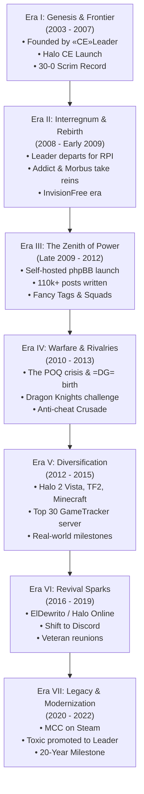

# Combat Experts Clan (`=CE=`) — Comprehensive Chronicle & History (2003 – 2022)

> **Motto:** *"Strength. Determination. Merciless. Forever."*  
> **Primary Arena:** *Halo: Combat Evolved*, *Halo Custom Edition*, *Halo 2 Vista*, *ElDewrito*, *Halo: The Master Chief Collection*  
> **Archival Scope:** Fall 2003 through January 2022  
> **Source Material:** Public historical archives, official community records, board logs, and member documentaries (*combate1_php1.sql*)  
> **Privacy Note:** In strict compliance with historical ethics and clan privacy standards, this document contains **zero** private communications. All chronicles are drawn exclusively from public records, official clan broadcasts, documentaries, and community forums.

---

```text
       ██████╗ ██████╗ ███╗   ███╗██████╗  █████╗ ████████╗    ███████╗██╗  ██╗██████╗ ███████╗██████╗ ████████╗███████╗
      ██╔════╝██╔═══██╗████╗ ████║██╔══██╗██╔══██╗╚══██╔══╝    ██╔════╝╚██╗██╔╝██╔══██╗██╔════╝██╔══██╗╚══██╔══╝██╔════╝
      ██║     ██║   ██║██╔████╔██║██████╔╝███████║   ██║       █████╗   ╚███╔╝ ██████╔╝█████╗  ██████╔╝   ██║   ███████╗
      ██║     ██║   ██║██║╚██╔╝██║██╔══██╗██╔══██║   ██║       ██╔══╝   ██╔██╗ ██╔═══╝ ██╔══╝  ██╔══██╗   ██║   ╚════██║
      ╚██████╗╚██████╔╝██║ ╚═╝ ██║██████╔╝██║  ██║   ██║       ███████╗██╔╝ ██╗██║     ███████╗██║  ██║   ██║   ███████║
       ╚═════╝ ╚═════╝ ╚═╝     ╚═╝╚═════╝ ╚═╝  ╚═╝   ╚═╝       ╚══════╝╚═╝  ╚═╝╚═╝     ╚══════╝╚═╝  ╚═╝   ╚═╝   ╚══════╝
                                    = C E =   C L A N   C H R O N I C L E S   ( 2 0 0 3  -  2 0 2 2 )
```

---

## Table of Contents
1. [Executive Historical Summary](#1-executive-historical-summary)
2. [Chronological Era Timeline (2003 – 2022)](#2-chronological-era-timeline-2003--2022)
   - [Era I: The Genesis & The Golden Frontier (Fall 2003 – 2007)](#era-i-the-genesis--the-golden-frontier-fall-2003--2007)
   - [Era II: The Interregnum & The Rebirth (2008 – Mid 2009)](#era-ii-the-interregnum--the-rebirth-2008--mid-2009)
   - [Era III: The Sovereign Forum Era & The Zenith of Power (Late 2009 – 2012)](#era-iii-the-sovereign-forum-era--the-zenith-of-power-late-2009--2012)
   - [Era IV: Warfare, Scrims, Dramas & Rivalries (2010 – 2013)](#era-iv-warfare-scrims-dramas--rivalries-2010--2013)
   - [Era V: Diversification, Migration & Maturation (2012 – 2015)](#era-v-diversification-migration--maturation-2012--2015)
     - The A§H» Sister Alliance & The 2014 Tournament
   - [Era VI: The Revival Sparks & The Twilight of Web Forums (2016 – 2019)](#era-vi-the-revival-sparks--the-twilight-of-web-forums-2016--2019)
     - The 2016 Four-Clan Coalition: A§H», =DG=, and «RG»
   - [Era VII: Pandemic Reunion, Modernization & The Eternal Legacy (2020 – 2022)](#era-vii-pandemic-reunion-modernization--the-eternal-legacy-2020--2022)
   - [The Post-Website Era: Discord Migration & Chance's Promotion](#the-post-website-era-full-discord-migration--chances-promotion-to-leader)
3. [The Organizational Matrix: Hierarchy, Tags & Squads](#3-the-organizational-matrix-hierarchy-tags--squads)
   - [The Tag Hierarchy](#the-tag-hierarchy)
   - [Military Ranks & The Revered Hall](#military-ranks--the-revered-hall)
   - [Specialized Squads](#specialized-squads)
   - [The Cadet Branch: Combat Experts Cadets (`=CEC=`)](#the-cadet-branch-combat-experts-cadets-cec)
4. [Pivotal Figures & Hall of Fame Biographies](#4-pivotal-figures--hall-of-fame-biographies)
5. [The Server Bastions & Legendary Battlegrounds](#5-the-server-bastions--legendary-battlegrounds)
6. [Clan Culture, Traditions & Memorable Lore](#6-clan-culture-traditions--memorable-lore)
7. [Epilogue: The 20-Year Legacy](#7-epilogue-the-20-year-legacy)

---

## 1. Executive Historical Summary

The **Combat Experts Clan** (`=CE=`) stands as one of the longest-running, most structured, and culturally resilient gaming institutions in competitive PC history. Born in the autumn of 2003 with the launch of *Halo: Combat Evolved* on PC, `=CE=` survived the entire arc of early 2000s internet gaming: from raw IP firewall routing and primitive dedicated servers, through the golden age of *Halo Custom Edition* map modding, the height of mid-2000s clan warfare, the rise and decline of independent phpBB community forums, to the modern revival across *ElDewrito*, Steam's *Halo: The Master Chief Collection*, and Discord.

Over its nineteen active years recorded in the archives, `=CE=` was defined by:
- An **undefeated competitive record** in early clan wars (30 multi-map matches, 0 defeats).
- Military-grade organizational discipline, complete with strict promotional criteria, anti-cheat surveillance, and detailed logging.
- An artistic and technical output spanning custom Halo maps, competitive montages, graphics suites, podcasts, and server automation tools.
- A profound bond of brotherhood that saw teenage gamers grow into engineers, architects, soldiers, programmers, and leaders, keeping their community alive across two decades.

---

## 2. Chronological Era Timeline (2003 – 2022)



---

### Era I: The Genesis & The Golden Frontier (Fall 2003 – 2007)

#### Fall 2003: The Foundation in the Fires of Halo PC
When Bungie and Gearbox Software released *Halo: Combat Evolved* for Windows PC in September 2003, online gaming was still on the wild frontier of the internet. Dedicated servers were practically nonexistent, consumer routers lacked automated port forwarding, and Windows XP firewalls routinely blocked server hosting.

In the autumn of 2003, an engineer-minded gamer named **«CE»Leader** founded the **Combat Experts Clan** (`=CE=`). Refusing to accept peer-to-peer latency, Leader reverse-engineered packet traversal through Linksys hardware and Windows firewalls, successfully creating one of the earliest public dedicated servers in the entire Halo PC community. Leader subsequently codified this knowledge into an authoritative community manual, *"How To Setup a Halo Dedicated Server"*, distributing it freely across the internet and laying the foundational architecture for competitive PC Halo.

```text
"Clan creation date was fall of 2003… Halo had just come out and we were all hardcore junkies 
(true addicts... lol). I figured out how to break through the Linksys and Windows firewalls 
(at that time knowledge on this was short) and was able to setup one of the first public 
Halo servers... To my best knowledge, =CE= is possibly the longest running clan on the planet."
— «CE»Leader, Historical Archival Letter (preserved in Topic #56)
```

#### Spring 2004: The Migration to Halo Custom Edition
In May 2004, Gearbox released *Halo Custom Edition* (Halo CE), unlocking custom map creation and modification tools (HEK). Recognizing that standard Halo would eventually grow stale, «CE»Leader led the entire clan into Custom Edition.

`=CE=` did not merely play on custom maps—they built them. «CE»Leader and officer **«CE»BIGBOOM** mastered the editing tools, releasing custom maps that achieved widespread circulation on *halomaps.org*. During this pioneering period, «CE»Leader established direct dialogue with **Tiamat**, the celebrated creator of *Coldsnap* and *Hugeass*, forging a creative ethos within `=CE=` centered around large-scale vehicle and tactical warfare.

#### Tactical Warfare & The 30–0 Clan War Dynasty
During this initial era, `=CE=` operated with military-style preparation. «CE»Leader and his right-hand man, **=CE=Falcon** (his neighbor and best friend, who later enlisted in the U.S. Army Rangers), developed an exhaustive tactical operational doctrine:
- **Topographical Cartography:** Leader and Falcon spent dozens of hours wandering empty maps, mapping coordinate grids, lines of sight, ambush positions, weapon drops, and vehicle respawn timings.
- **Role Specialization:** Combatants were formally segregated into **"Static"** operators (designated snipers, heavy ordnance overseers, counter-snipers) and **"Dynamic"** operators (flag runners, vehicle assault crews, rapid-response flankers).
- **Vehicle Counters:** Specific weapon protocols were codified (such as deploying Longsword tactical airstrikes from vertical angles to neutralize heavy Mythos tanks).

This level of tactical discipline gave `=CE=` an unprecedented competitive record: **they fought approximately 30 multi-map, three-round clan wars and never lost a single match.** At its peak during this period, clan membership fluctuated between 150 and 300 active players, cycling annually with the school calendar (surging in autumn, peaking in December/January, and cooling off in midsummer).

An early strategic alliance was forged during these years with **{IB} Infernal Blaze**, cemented by mutual respect between «CE»Leader and {IB} Inferno.

---

### Era II: The Interregnum & The Rebirth (2008 – Mid 2009)

#### The Abrupt Farewell
In late 2007 / early 2008, the founding era came to an unexpected halt. «CE»Leader was accepted into one of the world's most prestigious electrical engineering institutions—the Electric Power Engineering program at Rensselaer Polytechnic Institute (RPI). Facing grueling academic demands, Leader made the difficult decision to abruptly step away from gaming, shutting down the original clan operations virtually overnight. Falcon transitioned into the Army Rangers, and the clan seemed destined to become a legend of early Halo.

#### The Reconstruction: Addict, Morbus & InvisionFree
However, the spirit of `=CE=` refused to die. A core cadre of loyal members, led by **«CE»Addict** alongside veteran **Morbus**, resolved to resurrect the clan. Recognizing the legacy they inherited, Addict contacted «CE»Leader to seek his blessing. Leader formally passed the torch, commending Addict's honor, tactical acumen, and preservation of the original clan aura.

In 2008, Addict established a new community hub on **InvisionFree** (`z15.invisionfree.com/Combat_Experts_Clan`). They recruited fresh talent to rebuild the roster:
- A new **Falcon** (Falcon) arrived, honoring the callsign of Leader's original companion.
- **Ninja (Ninja / Spaz)** and **Ichigo (Ichigo)** joined the vanguard.
- Crucially, Ichigo scouted and recruited a vibrant player named **=CE= Plague**, who would go on to become the single most prolific poster and daily conversational anchor in the clan's history.

On **May 9, 2009**, the reformed clan structure was formally codified, marking the official anniversary date celebrated by the second-generation brotherhood.

---

### Era III: The Sovereign Forum Era & The Zenith of Power (Late 2009 – 2012)

#### December 18, 2009: The Launch of combatexpertsclan.com
By late 2009, InvisionFree's hosted service proved too limited for the clan's expanding ambitions. Under the technical leadership of **«CE»Addict**, **=CE=Toxic**, **«CE»Chance**, **Ithiane (Aegisdragon)**, and **=CE=Alteran (Lantean)**, the clan acquired its own domain and launched an independent, self-hosted phpBB 3 community platform: `combatexpertsclan.com`.

The transition unleashed an explosion of community activity. Within seven days of launch, members generated 1,469 posts. By the end of 2010, the community had authored **79,305 posts in a single calendar year**, followed by **34,665 posts in 2011**, creating a vibrant digital home of over 143,000 public contributions.

```text
┌────────────────────────────────────────────────────────┐
│             ANNUAL FORUM ACTIVITY MATRIX               │
├──────────────┬────────────────────────┬────────────────┤
│    Year      │      Public Posts      │  Era Dynamic   │
├──────────────┼────────────────────────┼────────────────┤
│ 2009 (Dec)   │         2,502          │ Board Launch   │
│ 2010         │        79,305          │ Golden Peak    │
│ 2011         │        34,665          │ High Stability │
│ 2012         │        17,029          │ Multi-Gaming   │
│ 2013         │         7,019          │ Mature Cadre   │
│ 2014         │         1,418          │ Real-Life Shift│
│ 2015         │           821          │ Server Focus   │
│ 2016 – 2019  │           416          │ ElDewrito Era  │
│ 2020 – 2022  │            74          │ MCC & Legacy   │
└──────────────┴────────────────────────┴────────────────┘
```

#### The Cultural Golden Age
This era was characterized by an elaborate military organizational structure. The community introduced distinct, prestigious symbols of leadership:
- **The Fancy Tags (`«CE»`):** Reserved exclusively for the supreme leadership council—the highest honor achievable in the clan. Leaders bearing fancy tags included `«CE»Addict`, `«CE»Thorn`, `«CE»eden`, `«CE»Chance`, `«CE»Music`, `«CE»Fuyuri`, and in later years, `«CE»Toxic`.
- **The Standard Tags (`=CE=`):** Worn proudly by fully inducted active combatants from Private to General.
- **The Cadet Tags (`≈CE≈` / `-CE-`):** Assigned to recruits undergoing training in the cadet program (`=CEC=`).

To keep operations running smoothly, `=CE=` instituted specialized squads:
1. **The RCON Squad:** High-integrity server administrators entrusted with remote server console passwords. They were bound by strict documentation rules, mandating that every kick, ban, or warning be recorded with photographic or cryptographic hash evidence in the dedicated **Documentaries** archive (Forum 66).
2. **The Graphics Squad:** Headed by artists such as `«CE»Thorn` (an architectural CAD designer), `=CE=Drake`, and `=CE=Birdy`, this squad produced custom signature tags, rank insignia, userbars, and desktop wallpapers.
3. **The Scrim & Combat Squad:** Managed by `«CE»Music`, `Rampage`, and `«CE»Addict`, responsible for vetting competitive rosters, scouting opposing clans, and organizing scrimmages.
4. **The Event & Podcast Squad:** Producers of the official `=CE= Podcast` and organizers of seasonal community tournaments (such as the *Holiday Hangover Event*, *Halloween Custom Map Bash*, and tryout mixxers).

---

### Era IV: Warfare, Scrims, Dramas & Rivalries (2010 – 2013)

The high visibility of `=CE=` dedicated servers made the clan a central player in community diplomacy, intense rivalries, and external conflicts.

#### 1. The POQ Exodus & The Genesis of =DG= (Early 2010)
In February 2010, internal conflicts erupted in the neighboring `POQ` clan. High-ranking POQ server host **POQbum** made the controversial decision to leave his clan and apply to `=CE=`. The move triggered gossip and tension across the Halo community.

`=CE=` leadership demonstrated exemplary maturity:
- On February 24, 2010, officer **Angel** and admin **Phantom** issued an official decree (*Topic #1251: "=CE= and POQ Drama All READ"*), ordering all `=CE=` members to cease gossip, treat POQbum strictly as a standard recruit, and respect POQ's sovereignty.
- POQbum integrated smoothly, bringing high-performance dedicated server infrastructure into `=CE=`.
- In July 2010, POQbum launched a sister clan initiative named **=DG= (Dark Guardians)** (Topic #3279), reviving the historic namesake on `DGclan.com` while maintaining shared servers with `=CE=`. When POQbum briefly stepped back, players like `=CE=Birdy` found refuge in `=CE=`'s open doors.

#### 2. The Complex =DG= Alliance: Brothers, Rivals & Mixed Blood
For over half a decade, `=DG=` served as `=CE=`'s most intricate alliance:
- **The Dual-Citizen Roster:** Numerous players held dual status or transitioned between both clans (notably `=CE=Exeon`, who served as an Admiral in `=DG=` while holding Sergeant rank in `=CE=`).
- **The "Who Would Win?" Debate (Topic #6556):** In January 2011, a 96-reply community debate ignited over whether `=CE=` or `=DG=` would prevail in a full-scale scrimmage. `=CE= Plague` famously declared that *"the power of both clans ends up destroying the universe and we end up in a draw."*
- **Joint Mixxers & Server Ties:** The two clans co-hosted numerous community events and shared admin privileges across mutual servers.
- **The 2015 Friction & Reconciliation:** In June 2015 (Topic #12808), during an unexpected `=CE=` forum outage, `=DG=` temporarily removed `=CE=` from their official ally roster citing perceived inactivity. Stalwarts `=CE=xZy`, `=CE=UGoBoom`, and `=CE=Shy` rallied the council to reassert `=CE=`'s enduring presence, reaffirming the unbreakable historical tie between the two clans.

#### 3. Scrimmage Showdowns: The Dragon Knights `{DK}` Affair
Between 2010 and 2012, dozens of clans issued formal scrimmage challenges to `=CE=` via the challenge registry (Forums 79 and 80), including `Team Rebellion`, `TeamMods (=TM=)`, `Clan Delta`, `»SG«`, `RIOT`, and `{DK} Dragon Knights`.

The most memorable confrontation occurred in March–April 2011 with `{DK}`:
- {DK} leader Ammar issued an urgent 6v6 challenge on Blood Gulch (Snipers, no shields, Warthogs only).
- `=CE=` noticed that {DK} had cloned their website styling and layout.
- An extensive scheduling effort ensued, managed by `«CE»Music`, `Rampage`, and `Plague`, complicated by a grueling 10-hour timezone difference between North America and the Middle East.
- On Saturday, April 23, 2011, the `=CE=` strike team (`Music`, `Blank`, `Hell`, `Tickle`, with `Addict` and `Plague` in reserve) assembled on the match server. After granting a 15-minute grace period, {DK} failed to appear, resulting in an official forfeit victory for `=CE=`.

#### 4. The Anti-Cheat Crusade & Imposter Wars
Because `=CE=` hosted the most populated public servers in Halo CE (including *Coldsnap*, *Ambush*, *FTLoBG*, and *Zombies*), they were constantly targeted by malicious actors:
- **Aimbotters & Wallhackers:** The RCON squad mounted a forensic campaign against notorious repeat cheaters (such as the tracking and unmasking of wallhackers like *Grimcall* and botters like *jesusJMF* and *kris_kof_df*).
- **The Hash-Ban Doctrine:** Rather than issuing arbitrary IP bans (which could be bypassed via dynamic IP resets), administrators were trained to extract and record unique CD-key cryptographic hashes, banning offenders permanently from all `=CE=` infrastructure.
- **Imposters:** Cheaters frequently masqueraded under clan tags (such as fake `=CE= tOx!C` and imposter leader handles). The RCON team maintained a zero-tolerance policy, deploying administrative scripts and spectator verification before taking swift action.

---

### Era V: Diversification, Migration & Maturation (2012 – 2015)

#### The Multi-Gaming Frontier
By 2012, the PC gaming ecosystem had evolved. While Halo Custom Edition remained the emotional bedrock of the clan, members branched out into contemporary titles:
- Dedicated squads were formed for *Team Fortress 2*, *Call of Duty: Modern Warfare 2*, *Garry's Mod*, *Minecraft* (with custom clan server builds), and *Planetside 2*.
- The community tested competitive waters in *Halo 2 Vista*, keeping the Spartan spirit alive on PC.

#### The A§H» Sister Alliance & The 2014 Tournament
Around 2012, former `PÕQ` member **SONOR** established the **`A§H»` Clan (The A§H Clan, theASHclan.org)**. Rapidly developing a stellar reputation for well-moderated dedicated servers (running popular Blood Gulch and infantry map rotations), `A§H»` became a natural close partner to `=CE=`. A rich bond developed between both rosters, with players like **`=DG=Enzo`**, **`Mandalor` (formerly `sHiNe!`)**, **`Voltagen`**, and later former `=CE=` veteran **`=CE=Greed`** (`br0wnbr0th4`) sharing ties across both communities.

In March 2014 (Topic #12394), `A§H»Killer` (former `FoV` Hitman) proposed a multi-mode friendly scrimmage series between `=CE=` and `A§H»` across both clans' servers. Engineered with an intricate bracket system awarding 1 point per CTF capture, 1 point per Slayer kill, and 5 points for the last survivor in Zombies (up to 75 points max), the tournament brought together `A§H»Killer`, `Mandalor`, `Enzo`, `Willrok`, `Voltagen`, and `Runriot` against `=CE=`'s `«CE»Addict`, `=CE=Giuli`, `=CE=Shy`, `=CE=Warthog`, and `=CE= Pydro`. The event highlighted the warm sportsmanship and friendly rivalry that sustained both communities during this transition era.

#### Real-World Milestones: From Teenagers to Professionals
The Biographies project launched in November 2012 by `«CE»Fuyuri` (Forum 104) captured a poignant transition: the adolescent founders of 2008–2010 were graduating from high school and university, entering careers, and navigating adult life:
- **`«CE»Thorn`:** Pursuing architecture and CAD design in Australia.
- **`«CE»Chance`:** Studying software engineering at the University of West Florida.
- **`«CE»Fuyuri`:** Building an IT career in New Zealand.
- **`Ground`:** Transitioning from high school freshman to computer engineering at university, having risen through the ranks to Colonel.
- **`=CE=Exeon`:** Studying astrophysics at University College London while working at BAE Systems.
- **`=CE=Four` (Inferno):** Balancing full-time work with college preparations in Ohio, rising to Captain twice.
- **`=CE=Durelle`:** Working in web hosting infrastructure in Canada while maintaining his reputation as the clan's legendary sniper (*"Durelle.exe"*).

#### Server Longevity: The Top 30 Triumph (October 2015)
Despite the aging of Halo CE's master browser, `=CE=`'s technical staff maintained round-the-clock server stability. In late October 2015 (Topic #12841), `«CE»Addict`, `=CE=Shy`, and `=CE=UGoBoom` celebrated a remarkable achievement: **a `=CE=` dedicated Halo server achieved a Top 30 global rank on GameTracker**—twelve years after the clan's founding.

---

### Era VI: The Revival Sparks & The Twilight of Web Forums (2016 – 2019)

#### The 2016 Four-Clan Coalition: A§H», =DG=, and «RG» (Early 2016)
By early 2016, physical retail copies of Halo PC were long out of print, and online lobby populations were dwindling worldwide. Recognizing the threat to classic PC Halo, `A§H` diplomat and leader **Crash** approached `«CE»Addict` and clan leadership in January 2016 (Topic #12881) with a historic proposal: forming a "United Nations" coalition among the four enduring pillar clans—**`=CE=`**, **`=DG=`**, **`A§H»`**, and **`«RG»`**.

Crash outlined a mutual cooperative pact:
- Joint dedicated server administration to pool remaining active players.
- Unified intelligence sharing against aimbotters, griefers, and hash-banned cheats.
- Cross-clan community events and reciprocal forum promotion.

`«CE»Addict`, `«CE»Chance`, and `«CE»Thorn` formally entered diplomatic negotiations, establishing essential **Autonomy** and **Sustainability** clauses ensuring every clan preserved its sovereign independence. The resulting four-clan summit, convened in `=DG=`'s Discord in February 2016, forged a vital mutual defense and companionship pact that sustained the remaining veteran communities through the twilight of the standalone game.

#### ElDewrito & The Halo Online Resurgence
Between 2016 and 2018, the PC Halo community experienced an unexpected renaissance through **ElDewrito** (Halo Online). For `=CE=`, this was a spiritual homecoming. The clan established Forum 108 (*ElDewrito*), organizing community game nights where veterans and newcomers relived classic Halo 3-style gameplay with PC mouse-and-keyboard precision.

#### The Communication Shift: From phpBB to Discord
As the late 2010s unfolded, real-time voice and text platforms supplanted traditional web bulletin boards across the internet. While forum post frequency tapered off, the brotherhood did not dissolve; it migrated. The official `=CE=` Discord server became the daily headquarters for banter, gaming sessions, and life updates, while the web forum was preserved as a sacred monument of the clan's golden years.

---

### Era VII: Pandemic Reunion, Modernization & The Eternal Legacy (2020 – 2022)

#### 2020: The Global Pandemic & The Great Reunion
When global lockdowns took effect in the spring of 2020, veterans who had not logged into the website in years returned to check on their brothers. Threads were revived with roll calls:
- `~CE~Trael`, `=CE=Giuli`, `Cactuar`, `=CE=Alteran`, and `«CE»Addict` checked in, counting posts and sharing well-wishes.
- Members reassembled on PC to play *Halo: The Master Chief Collection (MCC)* on Steam, bringing the journey full circle back to the classic Master Chief campaigns and multiplayer lobbies.

#### July 2020: The Preservation Initiative
On July 19, 2020, **=CE=Toxic** issued a historic call to arms:
```text
"I hope that everyone is staying safe during these times! 
We are in need of contributors to the new website project. Anyone with project management, 
coding, testing, database maintenance, systems administration, graphic design, or community 
management experience is welcomed and encouraged to help out in any way that they can... 
The point of contact is =CE=Toxic."
— =CE=Toxic , Public Announcement
```
This initiative spearheaded the complete modernization of the clan's legacy codebase—transitioning nineteen years of history into secure, containerized, modern architectures so that the records of `=CE=` would never be lost to time.

#### May 27, 2021: The Bestowal of the Final Fancy Tag
On May 27, 2021, clan patriarch **«CE»Addict** made a momentous announcement to the community (Topic #13253):

```text
"Over the years =CE=Toxic has been an outstanding member. =CE=Toxic really has been a major 
ingredient of the glue that keeps us together over the last 12+ years. The list of his 
contributions is very long and I am very proud to announce that we have a new Fancy Tag. 
Thank you «CE»Toxic for everything."
— «CE»Addict, Official Leadership Proclamation
```
After twelve years of tireless administrative stewardship, technical leadership, and unwavering loyalty, =CE=Toxic was officially invested with the coveted chevron **Fancy Tags**, taking his rightful place alongside Addict, Thorn, eden, and Chance in the clan's highest leadership circle as **«CE»Toxic**.

#### January 14, 2022: The Philosophical Sunset
The final recorded post in the historic forum database occurred on **January 14, 2022**, in a reflective discussion with `=DG=Morgan` titled *"What killed all the forums in the world (almost all)?"*.

`«CE»Toxic` provided the poetic closing words for an entire epoch of digital culture:
```text
"Definitely a change in the way that people use the internet. The rise of real-time 
communications and social networks has shifted the ways that we communicate online... 
This however, does not foster conversations, and I think that is why the spirit of 
forums lives on in the form of other platforms similar to Reddit, Facebook Groups, 
and others.

I always loved logging onto the forums in the morning while sipping a freshly-brewed coffee, 
and checking the unread posts."
— «CE»Toxic, Final Archival Post
```

#### The Post-Website Era: Full Discord Migration & Chance's Promotion to Leader
Following the conclusion of the forum's active history in early 2022, the clan completed its final platform evolution:
- **Decommissioning the Website:** With gaming culture and clan operations shifting permanently to modern real-time infrastructure, the historic phpBB community site was formally retired and shut down, preserved in secure archives for future generations.
- **The Discord Hearth:** All primary operations—daily communications, voice lobbies, event planning, and gaming sessions—permanently transitioned to the official **=CE= Discord** server, which serves as the active home of the clan today.
- **«CE»Chance Elevated to Clan Leader:** During this transition into the Discord era, clan patriarch **«CE»Addict** made one of the most significant leadership promotions in the clan's modern history: **=CE=Chance was officially promoted to Clan Leader (`«CE»Chance`)**. A foundational pillar of the community since May 9, 2009, Chance took his rightful place at the summit of clan leadership, steering the brotherhood into its modern Discord chapter alongside `«CE»Addict` and `«CE»Toxic`.

---

## 3. The Organizational Matrix: Hierarchy, Tags & Squads

### The Tag Hierarchy
A member's tags in game and on the forums conveyed their sacred standing within the clan:

| Tag Format | Designation | Description & Qualifications |
| :--- | :--- | :--- |
| **`«CE»Username`** | **The Fancy Tag** | **Supreme Leadership Council.** Reserved for Clan Leaders and founding elders who governed clan policy, finance, server infrastructure, and strategic diplomacy. |
| **`=CE=Username`** | **Standard Tag** | **Full Clan Member.** Awarded to initiated Spartans from Private First Class through General who had passed tryouts, application votes, and background hash checks. |
| **`≈CE≈Username`** | **Cadet Tag** | **Combat Experts Cadets (`=CEC=`).** Worn by junior recruits and cadet officers undergoing formal training and behavioral evaluation. |
| **`-CE-Username`** | **Probationary / Recruit** | Worn by new applicants and recruits during their initial probationary evaluation period. |

---

### Military Ranks & The Revered Hall

```text
               ┌────────────────────────────────────────────────────────┐
               │              THE COMBAT EXPERTS HIERARCHY              │
               ├────────────────────────────────────────────────────────┤
               │   SUPREME COMMAND   : «CE» Leadership (Fancy Tags)     │
               │   HIGH COMMAND      : General, Colonel, Major          │
               │   OFFICER CORPS     : Captain, Lieutenant              │
               │   NON-COMMISSIONED  : Sergeant, Specialist             │
               │   ENLISTED RANKS    : Private First Class, Private     │
               │   PROBATIONARY      : Recruit, Cadet (≈CE≈)            │
               ├────────────────────────────────────────────────────────┤
               │   THE REVERED HALL  : Legendary Retired Elders         │
               └────────────────────────────────────────────────────────┘
```

#### The Revered Group (Group #40)
The highest honor bestowed upon a veteran departing active duty. Defined officially in clan law as:  
> *"This group consists of people that are former members of =CE= that contributed something of worth towards =CE=."*

Inductees into the Revered Hall of Fame included:
- **`BIGBOOM`** (Legendary custom mapmaker from the 2003–2004 founding era)
- **`Falcon`** (Original founding right-hand man & second-generation veteran)
- **`«CE»Addict`** (Reconstruction Leader & Patriarch)
- **`«CE»Toxic`** (Technical Pillar, Infrastructure Steward & 12+ Year Anchor)
- **`«CE»Thorn`** (Lord Thorn, Colonel, Master Artist)
- **`«CE»eden`** (Grif / Chewie, 6,200+ posts, beloved pillar)
- **`«CE»Chance`** (Software Engineer, Admin, Leader)
- **`«CE»Music`** (Scrim Master, Major, Leader)
- **`«CE»Fuyuri`** (Biographies Creator, IT Leader)
- **`=CE= Plague`** (All-Time #1 Poster, 7,844 posts)
- **`=CE=Alteran`** (Lantean, Technical Enforcer & Mod)
- **`Fire`** (3,500+ posts, moderation pillar)
- **`=CE=Kradon`** (3,400+ posts, steadfast veteran)
- **`Ithiane`** (Aegisdragon, Secretary of War)
- **`Blank`** / Blanket (2,100+ posts)
- **`Flóòk`**, **`Ground`**, **`=CE=Horns`**, **`Nuwbz`**, **`=CE=Exeon`**, **`=CE=RedFlag`**, **`=CE=Kilo23`**, **`Cowboy` (Lucky 7)**, **`Rampage`**, **`Cactuar`**, **`Angel`**, **`=CE=Durelle`**, and **`=CE=Drake`**.

---

### Specialized Squads

1. **RCON Squad:** The police force of `=CE=` dedicated servers. Empowered with remote server control passwords, members were bound by strict accountability rules. Abuse of admin powers resulted in immediate stripping of rank.
2. **Graphics Squad:** Created userbars, clan logos, desktop backgrounds, and customized forum avatars. Their artwork gave `=CE=` one of the most distinctive visual signatures in the Halo PC scene.
3. **Mapping Squad:** Continued the proud tradition of «CE»Leader and «CE»BIGBOOM, creating, modifying, and hosting custom multiplayer maps.
4. **Video Squad:** Captured Xfire recordings and edited cinematic frag montages showcasing clan tryouts, scrim victories, and humorous glitch antics for YouTube.
5. **Event & Podcast Squad:** Planned community mixxers and produced the `=CE= Podcast`, discussing clan news, gaming industry trends, and interviews with community personalities.

---

### The Cadet Branch: Combat Experts Cadets (`=CEC=`)
Recognizing that many eager applicants were too young or lacked competitive seasoning for the main roster, `=CE=` established a dedicated feeder academy: **Combat Experts Cadets (`=CEC=`)**.
- Cadets wore the distinctive tilde tags: **`≈CE≈`**.
- They advanced through an independent cadet hierarchy: *Cadet Recruit → Cadet → Cadet Lance Corporal → Cadet Corporal → Cadet Warrant Officer → Officer Cadet*.
- Senior officers served as instructors (such as `«CE»Thorn` and `[TS]` instructors).
- Dedicated training forums (Forums 97, 98, 99, 103) taught server etiquette, anti-cheat detection, teamwork, and marksmanship. Cadets who demonstrated character and loyalty were eventually promoted into full `=CE=` Spartan status.

---

## 4. Pivotal Figures & Hall of Fame Biographies

```text
┌────────────────────────────────────────────────────────────────────────┐
│                      PIVOTAL COMMUNITY FIGURES                         │
└────────────────────────────────────────────────────────────────────────┘
```

### «CE»Leader (Founding Father, 2003 – 2008)
The visionary who started it all in the fall of 2003. A brilliant technical mind who bypassed early Linksys/Windows firewalls to set up the clan's first dedicated Halo server, penned the community's definitive server setup manual, built custom maps with BIGBOOM, conversed with mapmaker Tiamat, and led `=CE=` through an undefeated 30–0 clan war record before departing for Rensselaer Polytechnic Institute (RPI) to study electric power engineering.

### «CE»Addict (The Patriarch & Rebuilder, 2008 – Present)
The indispensable heart and soul of second-generation `=CE=`. When Leader departed, Addict took the reins, earned Leader's blessing, built the InvisionFree community, and financed and launched the self-hosted phpBB site in 2009. Addict governed with warmth, fairness, and fierce loyalty, serving as the steadfast father figure of the clan across more than a decade.

### «CE»Toxic  (The Technical Cornerstone & Anchor, 2009 – Present)
Registered on December 13, 2009 (User #53), =CE=Toxic became the bedrock of `=CE=`'s survival and continuity. Serving across 12+ years as system administrator, server host, anti-cheat enforcer, and webmaster, he was officially described by Addict as *"the glue that keeps us together."* In May 2021, he was rightfully elevated to supreme leadership with the coveted **Fancy Tags (`«CE»Toxic`)**. In 2020–2022, =CE=Toxic spearheaded the preservation of the clan's infrastructure, ensuring the memories and records of `=CE=` would survive indefinitely.

### «CE»Thorn (Lord Thorn) (The Architect & Enforcer, 2008 – Present)
One of the most formidable personalities in clan history. An architect and CAD designer from Australia, Thorn was the fastest member to rise to Colonel, later ascending to full Leader. Known for his razor-sharp wit, architectural precision, and uncompromising standards, Thorn directed the Graphics Squad, ran the Cadet Academy, and designed the visual identity of `=CE=`.

### «CE»eden (Grif / Chewie) (The Beloved Pillar, 2010 – Present)
Author of 6,212 posts, eden was one of the most dedicated and warm-hearted leaders in clan history. A self-professed *Red vs. Blue* and sci-fi fanatic, eden was beloved across all ranks for his constant presence in servers, his encouragement of recruits, and his steadfast dedication to the community.

### =CE= Plague (The Voice of the Clan, 2009 – Present)
The undisputed **all-time post champion of `=CE=` with 7,844 posts**. Recruited in the early days by Ichigo, Plague was the vibrant pulse of daily forum life. Whether joking in *The Spam Forum*, dissecting scrimmage mechanics, or welcoming newcomers, Plague's humor and warmth defined the everyday camaraderie of `=CE=`.

### «CE»Chance (The Software Engineer & Clan Leader, 2009 – Present)
Joined on May 9, 2009. A software engineering scholar at the University of West Florida, Chance was celebrated for his dry intellect, sharp wit, and deep philosophical musings. Having served for over a decade as a vital administrator, philosopher, and voice of reason, Chance was officially promoted to Clan Leader by «CE»Addict following the sunset of the website, taking the helm to guide `=CE=` into its modern Discord era.

### =CE=Alteran (Lantean) (The Sentinel, 2009 – Present)
Author of 4,277 posts. Alteran served as a stalwart moderator, server guardian, and technical troubleshooter. Fiercely protective of clan standards, Alteran logged countless hours policing servers and maintaining forum health.

### «CE»Music (The Scrim Commander, 2009 – Present)
Major and Clan Leader who commanded the Scrim Squad. Music was the diplomatic and strategic bridge who negotiated clan war parameters, resolved disputes with rival clans, and led the competitive line during the high-stakes matches of 2010–2012.

### «CE»Fuyuri (The Chronicler & Leader, 2010 – Present)
An IT specialist from New Zealand (2,788 posts). Fuyuri brought boundless energy to the officer corps and was the visionary architect behind the **Clan Biographies (Forum 104)** project, creating a lasting space for members to chronicle their personal lives and aspirations.

### =CE=BIGBOOM (The Master Mapmaker, 2003 – Present)
Co-commander alongside «CE»Leader in 2003–2004. BIGBOOM was a pioneering mapmaker whose custom creations placed `=CE=` on the global Halo CE modding map. In later years, as a mechanical engineer graduate from Michigan Tech, he returned to the forums to celebrate the clan's survival.

### =CE=Falcon (the 2nd Falcon) (The Country Spartan, 2008 – Present)
Taking up the legendary callsign of Leader's original companion, Falcon brought authentic country charm, paintball enthusiasm, and genuine camaraderie to `=CE=`. His return in December 2010 ("Back In Black") was greeted with widespread celebration across the entire roster.

### Ground (The Poet & Engineer, 2009 – Present)
Joined as a high school freshman, grew up within `=CE=`, and rose all the way to Colonel. A computer engineering student with a passion for robotics, AI, progressive rock, and poetry, Ground epitomized the journey of a young gamer maturing into a scholar among clan brothers.

### =CE=Durelle (The Unstoppable Sniper, 2009 – Present)
Canadian web technician and competitive marksman whose lethal sniping precision was so feared that clan mates jokingly accused him of running an automated hack called *"Durelle.exe"*.

---

## 5. The Server Bastions & Legendary Battlegrounds

The Combat Experts Clan's legendary reputation was built on its custom dedicated servers, which ran 24/7 and attracted thousands of players worldwide:

```text
┌────────────────────────────────────────────────────────────────────────┐
│                   HISTORIC =CE= SERVER DIRECTORY                       │
├──────────────────┬───────────────────┬─────────────────────────────────┤
│ Server Name      │ Primary Map(s)    │ Combat Specialty                │
├──────────────────┼───────────────────┼─────────────────────────────────┤
│ =CE= Coldsnap    │ Coldsnap          │ Heavy Armor, Jets & Longswords  │
│ =CE= FTLoBG      │ Blood Gulch       │ "For The Love of Blood Gulch"   │
│ =CE= Ambush      │ Ambush (Custom)   │ Tactical Mid-Range Firefights   │
│ =CE= Snipers     │ Various           │ Precision No-Shield Marksmanship│
│ =CE= Zombies     │ Custom Infection  │ Infection & Survival Horror     │
│ =CE= Snow Grove  │ Snow Grove        │ Winter Operations & Vehicle CTF │
│ =CE= SWAT        │ Tactical Maps     │ Instant-Kill Tactical Combat    │
│ =CE= Haloball    │ Haloball Arena    │ Custom Physics Sports Matchups  │
└──────────────────┴───────────────────┴─────────────────────────────────┘
```

---

## 6. Clan Culture, Traditions & Memorable Lore

### 1. "The Spam Forum" & Forum Culture
Forum 8 (*The Spam Forum*) was the vibrant social pub of `=CE=`, generating over 28,500 posts. Here, members debated music, shared photography, engaged in endless counting threads (*"A count to 2000"*), and cultivated inside jokes like *"Cake and Schnapps"* and the legendary *"Clam"* emoticons.

### 2. "Durelle.exe"
Whenever `=CE=Durelle` went on an impossible sniping spree, dominating opposing players across the entire expanse of Blood Gulch or Gephyrophobia, members declared that *Durelle.exe* had been executed—a running tribute to his natural marksmanship.

### 3. The Mandatory Documentaries Rule
Unlike ordinary gaming clans where admins banned players on a whim, `=CE=` maintained a strict judicial code. Every RCON Squad member was required to maintain a personal topic in Forum 66 (*Documentaries*). When a ban was issued, the admin had to record:
- The exact server name and timestamp.
- The command string executed (`sv_ban [player_id]`).
- The player's unique cryptographic CD-key hash.
- Photographic or video evidence of the infraction (aimbot snapping, wallhacking, or severe abusive toxicity).

### 4. Brotherhood Across Borders
`=CE=` was truly global. From the United States and Canada, to the United Kingdom, New Zealand, Australia, Brazil, and Pakistan (`=CE=Shy`), members coordinated events across twelve time zones. When members faced personal hardships, health struggles, or grief, the community rallied around them with genuine support and care.

---

## 7. Epilogue: The 20-Year Legacy

From its inception in the autumn of 2003 through its twentieth year, the Combat Experts Clan proved that an online gaming community could transcend the boundaries of a video game.

What began as a pioneering effort by **«CE»Leader** to host dedicated servers for *Halo: Combat Evolved* evolved under **«CE»Addict**, **«CE»Toxic**, **«CE»Thorn**, and their brethren into a digital brotherhood that lasted nearly two decades. They withstood the rise and fall of game titles, the obsolescence of server browsers, and the shifting tides of the internet.

As the community looks back across the archives, the motto adopted nearly two decades ago remains as true today as it was in the beginning:

$$\text{Strength. Determination. Merciless. Forever.}$$

**This document stands as the permanent historical testament to the members of the Combat Experts Clan (`=CE=`)—to those who carried the flag, held the high ground, and kept the flame alive.**

---
*Chronicle compiled and verified from the official archives of combate1_php1.sql.*  
*Preserved for all past, present, and future Spartans of `=CE=`.*
